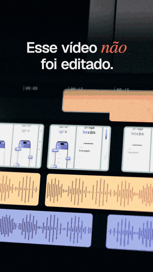
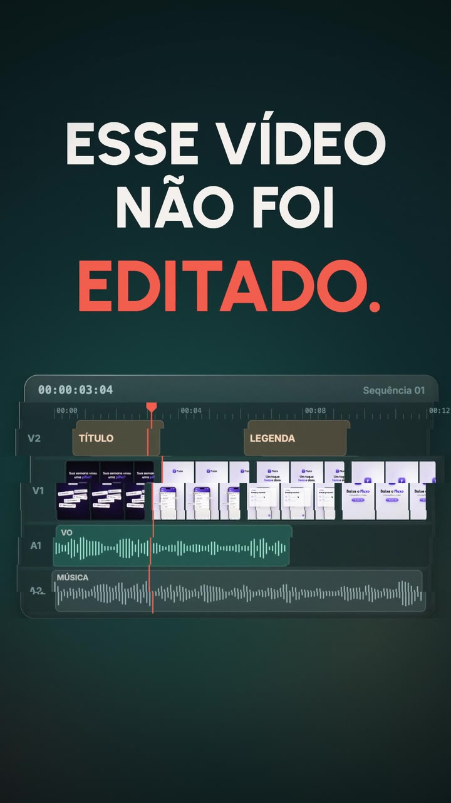
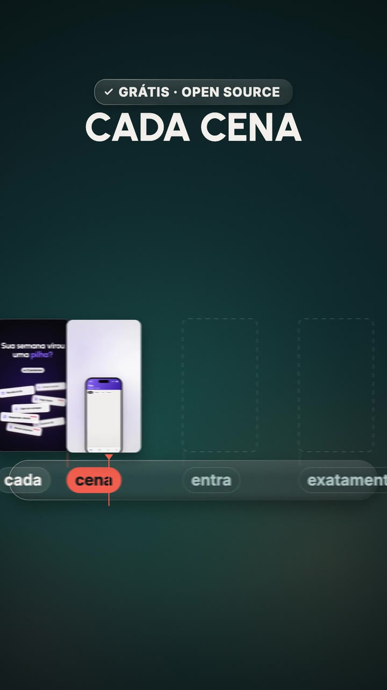
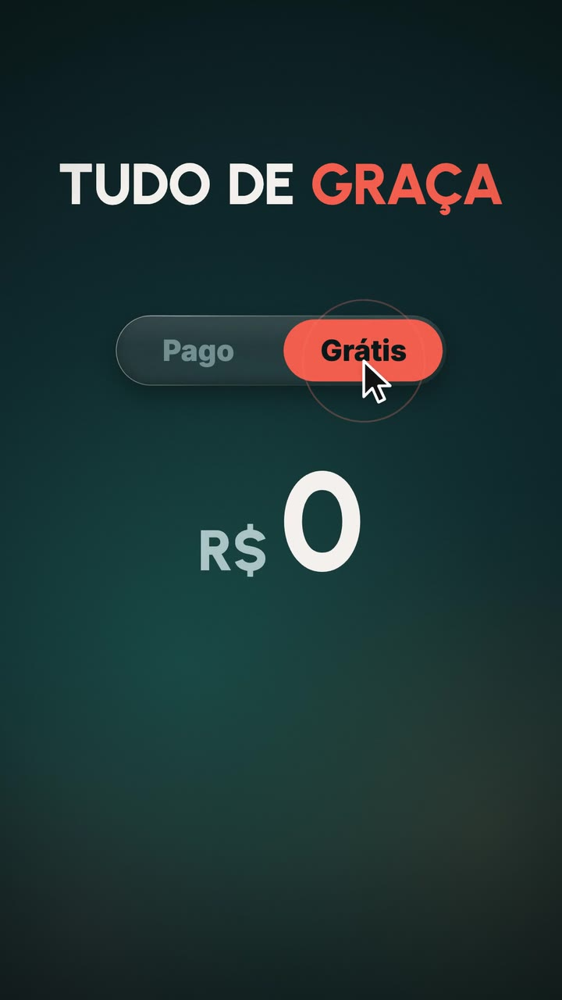
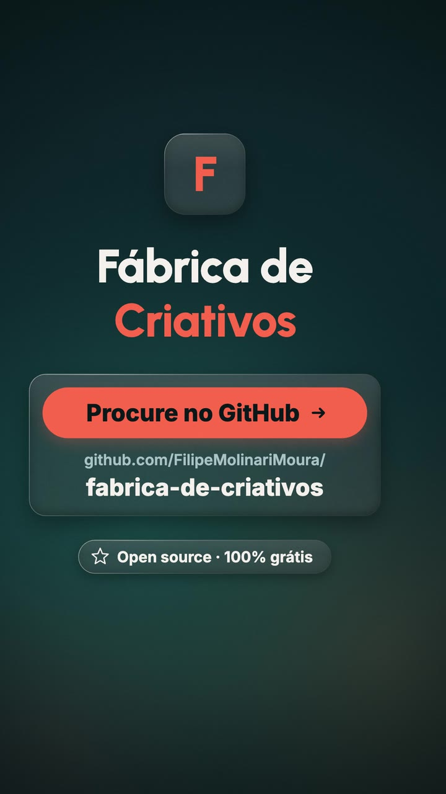
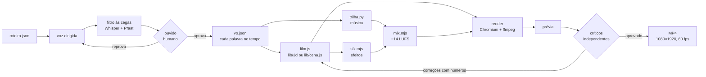

<div align="center">

# Fábrica de Criativos

**Anúncios em vídeo que saem de código: você escreve o roteiro, a IA narra, e cada cena entra na palavra falada.**

[](https://github.com/FilipeMolinariMoura/fabrica-de-criativos/actions/workflows/ci.yml)
[](CHANGELOG.md)
[](LICENSE)
[](LICENSE-docs.md)
[](dist/Fabrica-de-Criativos.pdf)

<a href="https://github.com/FilipeMolinariMoura/fabrica-de-criativos/releases/latest">
  
</a>

<sub>Este anúncio foi programado, não editado. O código está em <a href="exemplos/bancada"><code>exemplos/bancada</code></a>.<br>
<a href="https://github.com/FilipeMolinariMoura/fabrica-de-criativos/releases/latest">Assista em 60 fps, com som, na página de versões.</a></sub>

</div>

---

## A história em sete linhas

Editor de timeline não escala: trocar uma palavra do roteiro obriga a regravar a voz e arrastar todos os cortes de novo.

Então o vídeo virou **código**. Cada quadro é uma função do tempo, e cada cena começa numa palavra da narração.

A primeira versão funcionava. Era determinística, sincronizada, dentro do padrão de áudio, com nota 8 na própria rubrica.

O autor assistiu e reprovou com uma palavra: **cru**.

A versão 2.0 é a resposta, em cinco peças: **pesquisa de referências** que transforma "parece caro" em 12 regras com números; **look-dev** antes de construir; **3D fotorrealista** no navegador; **voz dirigida** como se dirige um locutor; e **críticos independentes**, porque quem constrói não aprova o próprio trabalho.

Tudo está aqui: o método, o código, os números, e também o que deu errado.

## Antes e depois

O mesmo roteiro, os mesmos momentos, duas versões.

<table>
<tr>
<th></th>
<th align="center">Gancho</th>
<th align="center">Cena na palavra</th>
<th align="center">"Custa zero"</th>
<th align="center">Cartão final</th>
</tr>
<tr>
<td><b>1.x</b><br><sub>2D em canvas<br><i>reprovada</i></sub></td>
<td></td>
<td></td>
<td></td>
<td></td>
</tr>
<tr>
<td><b>2.0</b><br><sub>3D em three.js<br><i>A bancada</i></sub></td>
<td></td>
<td></td>
<td></td>
<td></td>
</tr>
</table>

| Medida | Versão 1.x | Versão 2.0 |
|---|---|---|
| Quadro ocupado por conteúdo | 3% a 21% | assunto em mais da metade da largura, em todo plano |
| Preto mais escuro | 23/255 | 4 a 6/255 nos quadros de estilo |
| Cortes secos | 0 em 32 s | 16 planos em 35 s |
| Câmera, luz e sombra | nenhuma | lente de 50 a 135 mm, luz de estúdio, sombra de luz de área |

Como essas medidas foram tiradas: [capítulo 9 da documentação](docs/09-pesquisa-de-referencias.md#94-análise-de-lacunas).

## O que você recebe

| | |
|---|---|
| **Um método em 10 etapas** | Do briefing à entrega, com entrada, saída e portão de qualidade em cada etapa. [docs/01-metodo.md](docs/01-metodo.md) |
| **Um kit de código** | Dois motores de filme (2D em canvas e 3D fotorrealista em three.js), scripts de voz, trilha, efeitos, mixagem e conferência |
| **Três exemplos completos** | [`demo`](exemplos/demo) (aplicativo fictício, 2D) · [`divulgacao`](exemplos/divulgacao) (o anúncio 2D reprovado) · [`bancada`](exemplos/bancada) (o anúncio 3D) |
| **Um guia em PDF** | A versão diagramada do método, em 27 páginas. [dist/Fabrica-de-Criativos.pdf](dist/Fabrica-de-Criativos.pdf) |
| **Um relatório técnico** | Em formato de artigo, com resumo em português e inglês, avaliação, limitações e ética. [docs/relatorio-tecnico.md](docs/relatorio-tecnico.md) |

## Começo rápido

Pré-requisitos: Node.js 18 ou mais novo, [uv](https://docs.astral.sh/uv/), ffmpeg e Whisper. O `make setup` avisa o que falta. O motor 2D roda em macOS e Linux. **O motor 3D só foi testado em macOS** (Apple Silicon).

```bash
git clone https://github.com/FilipeMolinariMoura/fabrica-de-criativos
cd fabrica-de-criativos
make setup          # dependências e conferência das ferramentas
make demo           # exemplo 2D: voz gratuita + trilha + efeitos + mixagem + prévia
```

A prévia sai em `entrega/previas/`. Agora o filme 3D:

```bash
make contato3d FILME=exemplos/bancada     # folha de contato dos 16 planos, em segundos
```

A folha sai em `out/exemplos/bancada/contato.jpg`. O filme inteiro sai com `make final3d FILME=exemplos/bancada`, depois que você gerar a narração (ela não vai no repositório). O passo a passo está em ["Como reproduzir" no estudo de caso](docs/14-estudo-de-caso-a-bancada.md#148-como-reproduzir).

Para começar um criativo seu:

```bash
scripts/novo_criativo.sh a01 "Meu primeiro criativo"
```

Depois siga o [método](docs/01-metodo.md).

<details>
<summary><b>Usar o Claude Code com um modelo aberto, sem pagar</b></summary>

```bash
ollama pull qwen3-coder:30b && ollama serve
export ANTHROPIC_BASE_URL=http://localhost:11434 ANTHROPIC_AUTH_TOKEN=ollama ANTHROPIC_API_KEY=""
claude --model qwen3-coder:30b
```

Requisitos de memória e cuidados: [docs/03-trilha-gratuita.md](docs/03-trilha-gratuita.md).

</details>

## O método em 10 etapas

| # | Etapa | O que você faz | Sai daqui com | Leia |
|---|---|---|---|---|
| 1 | **Briefing** | Confirma produto, público, dor, CTA e telas reais | `briefing.md` | [Método](docs/01-metodo.md#11-briefing) |
| 2 | **Referências** | Lê filmes do gênero sem baixar vídeo e escreve regras com números | Tabela, regras e análise de lacunas | [Pesquisa de referências](docs/09-pesquisa-de-referencias.md) |
| 3 | **Roteiro** | Escreve 30 segundos para o ouvido e aprova o texto | `roteiro.json` | [Roteiro e copy](docs/07-roteiro-e-copy.md) |
| 4 | **Voz dirigida** | Aprova o tom em amostras curtas, dirige, gera com sementes | Tomada aprovada de ouvido | [Voz dirigida](docs/12-voz-dirigida.md) |
| 5 | **Narração no tempo** | Marca o instante de cada palavra | `vo.json` | [Método](docs/01-metodo.md#15-narração-no-tempo) |
| 6 | **Look-dev** | Constrói quatro quadros de estilo e dá nota honesta | Quadros aprovados | [Look-dev](docs/10-look-dev.md) |
| 7 | **Filme** | Programa os planos, cada corte preso a uma palavra | `film.js` | [3D fotorrealista](docs/11-3d-fotorrealista.md) · [Motor 2D](docs/06-tecnicas-de-motion.md) |
| 8 | **Som** | Sintetiza trilha e efeitos e mede a mixagem | `mix.wav` em −14 LUFS | [Som](docs/13-som.md) |
| 9 | **Crítica independente** | Entrega a prévia a críticos que não construíram o filme | Correções com números | [Qualidade](docs/08-qualidade-e-solucao-de-problemas.md) |
| 10 | **Render, variações e entrega** | Renderiza a 60 fps e confere o arquivo | MP4 1080×1920 | [Qualidade](docs/08-qualidade-e-solucao-de-problemas.md#83-especificação-de-entrega) |

## Gratuito × pago

Dá para fazer tudo sem pagar. Vale saber onde está a diferença.

| Etapa | Trilha gratuita | Trilha paga | Diferença real |
|---|---|---|---|
| Agente | Claude Code com modelo aberto no Ollama (`qwen3-coder:30b`) | Claude Code com plano Claude | O modelo aberto erra mais em tarefa longa. Peça uma etapa por vez |
| Filme 2D e 3D | `lib/cena.js` e `lib/3d` | iguais | **Nenhuma.** O 3D fotorrealista é código aberto |
| Trilha e efeitos | Sintetizados em código | iguais | Nenhuma |
| Narração | Kokoro (local) ou Fish Audio (modelo gratuito) | ElevenLabs com direção | **A maior.** Veja abaixo |
| Conferência da fala | Whisper e Praat | iguais | Nenhuma |
| Render | Playwright e ffmpeg | iguais | Nenhuma |

> **Sobre a voz, sem rodeio.** O filme diz "custa zero: os modelos são abertos". Isso vale para o agente, a imagem, a música, os efeitos e o render. A narração que foi ao ar veio da trilha paga: as duas vozes gratuitas foram reprovadas de ouvido para este anúncio. O plano usado custa US$ 5 por mês, e todas as tentativas somadas gastaram da ordem de 12 a 15 mil dos 30 mil créditos mensais. A história inteira está em [docs/12-voz-dirigida.md](docs/12-voz-dirigida.md).

Detalhes: [trilha gratuita](docs/03-trilha-gratuita.md) · [trilha paga](docs/04-trilha-paga.md).

## Como funciona



Três ideias sustentam o desenho:

- **O filme é uma função pura do tempo.** `window.seek(t)` desenha o quadro *t*. O mesmo commit gera o mesmo MP4.
- **Tudo é preso à palavra.** Corte, foco, luz, objeto e som perguntam ao `vo.json` quando a palavra é dita. Trocar a voz reposiciona o filme.
- **Uma câmera que soma.** No motor 3D, cada quadro é a média de 192 a 768 renders, cada um com a câmera num ponto da abertura da lente, num instante do obturador e com as luzes num ponto da própria área. Daí saem o desfoque de lente, o desfoque de movimento e a sombra suave.

## Mapa do repositório

```
fabrica-de-criativos/
├─ docs/               o manual completo, o relatório técnico e as referências
├─ lib/
│  ├─ 3d/              motor 3D: câmera de acumulação, estúdio, modelos, telas, renderizador
│  ├─ cena.js          motor 2D: primitivas de motion design
│  └─ motion.js        harness do filme como função do tempo
├─ scripts/            voz, filtro às cegas, narração no tempo, trilha, variações, entrega
├─ exemplos/
│  ├─ bancada/         o anúncio 3D desta versão
│  ├─ divulgacao/      o anúncio 2D da versão 1.1
│  └─ demo/            aplicativo fictício, usado no `make demo`
├─ templates/          briefing, roteiro, referências, quadros de estilo, crítica, checklist
├─ ae/logo3d/          logo 3D no After Effects por script (não testado nesta versão)
├─ vendor/motion-reel  motor de render e áudio (MIT, v1.3.0)
├─ ebook/  dist/       fonte e PDF do guia
└─ Makefile            `make ajuda` lista os atalhos
```

## Documentação

O índice com caminhos de leitura por objetivo está em [docs/README.md](docs/README.md).

| | Documento | Conteúdo |
|---|---|---|
| | [Guia em PDF](dist/Fabrica-de-Criativos.pdf) | O método diagramado, para ler de uma vez |
| 0 | [Visão geral](docs/00-visao-geral.md) | A história e como ler |
| 1 | [Método](docs/01-metodo.md) | As 10 etapas, entradas, saídas e portões de qualidade |
| 2 | [Ferramentas](docs/02-ferramentas.md) | Inventário, licenças e o que foi descartado |
| 3 | [Trilha gratuita](docs/03-trilha-gratuita.md) | Ollama, modelos abertos, Kokoro, Fish Audio |
| 4 | [Trilha paga](docs/04-trilha-paga.md) | O que vale pagar e quanto custou |
| 5 | [Skills](docs/05-skills.md) | Skills por etapa e como pedir ao agente |
| 6 | [Técnicas de motion](docs/06-tecnicas-de-motion.md) | O motor 2D |
| 7 | [Roteiro e copy](docs/07-roteiro-e-copy.md) | Fórmula, famílias de gancho, antes e depois do roteiro |
| 8 | [Qualidade](docs/08-qualidade-e-solucao-de-problemas.md) | Rubrica, críticos independentes, solução de problemas |
| 9 | [Pesquisa de referências](docs/09-pesquisa-de-referencias.md) | As 12 regras do visual caro |
| 10 | [Look-dev](docs/10-look-dev.md) | Quadros de estilo e nota honesta |
| 11 | [3D fotorrealista](docs/11-3d-fotorrealista.md) | O pipeline, a luz, os materiais, os tropeços |
| 12 | [Voz dirigida](docs/12-voz-dirigida.md) | O que foi reprovado e o processo que funcionou |
| 13 | [Som](docs/13-som.md) | Trilha, efeitos e mixagem medida |
| 14 | [Estudo de caso](docs/14-estudo-de-caso-a-bancada.md) | O making-of de A bancada |
| | [Relatório técnico](docs/relatorio-tecnico.md) | Formato de artigo |
| | [Referências](docs/referencias.md) | Bibliografia em ABNT |

O PDF é gerado com `node ebook/build.mjs`.

## Perguntas frequentes

<details>
<summary><b>Preciso pagar alguma coisa?</b></summary>

Não. O agente pode ser um modelo aberto rodando na sua máquina, a voz pode ser Kokoro ou Fish Audio, e todo o resto é código aberto. O que você perde sem pagar é qualidade de narração e confiabilidade do agente em tarefas longas. Se for pagar uma coisa só, pague a voz.

</details>

<details>
<summary><b>Precisa de placa de vídeo?</b></summary>

Precisa de uma GPU que o navegador consiga usar, e a integrada serve. O filme deste repositório foi renderizado num Apple M1 Pro com 16 GB: de 35 a 40 minutos para 35 segundos a 60 fps. Em hardware mais fraco, use menos amostras por quadro.

Um limite honesto: o renderizador 3D abre o Chromium com o backend gráfico Metal, que só existe no macOS. Em Linux e Windows ele não foi testado, e essa opção precisa ser trocada em `lib/3d/render.mjs`. O motor 2D não tem essa restrição.

</details>

<details>
<summary><b>Por que não usar IA de vídeo?</b></summary>

Por três motivos. Texto e interface saem errados, e num anúncio de software a interface é a prova. Os modelos entregam de 24 a 30 fps. E o resultado não se repete: você não consegue trocar uma palavra e renderizar de novo. No caso deste filme havia um quarto motivo: ele afirma que foi programado. A análise completa está no [capítulo 9](docs/09-pesquisa-de-referencias.md#96-por-que-não-vídeo-generativo).

</details>

<details>
<summary><b>Funciona com outro agente ou outro modelo?</b></summary>

Sim. O método é um conjunto de arquivos e scripts. Qualquer agente que leia a documentação e rode comandos serve: Claude Code com modelo da Anthropic ou aberto, OpenCode, Aider, Qwen Code. Você também pode seguir tudo à mão, sem agente.

</details>

<details>
<summary><b>Posso usar em trabalho para cliente?</b></summary>

Pode. O código é MIT e a documentação é CC BY 4.0. Três cuidados: confira a licença comercial da voz que escolher, use só telas reais do produto, e nunca envie material de cliente para um repositório público. Se quiser contribuir de volta, contribua com código e técnica, nunca com o material do trabalho.

</details>

<details>
<summary><b>Quanto tempo leva?</b></summary>

O `make demo` roda em minutos. Um criativo 2D, depois do kit montado, leva de uma a duas horas, quase todas de revisão humana (estimativa do autor). O filme 3D deste repositório levou menos de um dia, com vários agentes em paralelo e muitas rodadas; o render final é a menor parte disso.

</details>

<details>
<summary><b>A voz ficou sem emoção. E agora?</b></summary>

É o problema mais comum, e a conferência automática não o detecta. Volte um passo: gere só o gancho e o CTA em quatro a sete variações e escolha o tom de ouvido. Depois dirija: marcações de tom, ênfase em caixa alta, reticências para pausa, idioma forçado. Reescreva o roteiro para dar à voz o que cantar, com perguntas e frases curtas depois de uma longa. O passo a passo está em [docs/12-voz-dirigida.md](docs/12-voz-dirigida.md).

</details>

<details>
<summary><b>O que este projeto não promete?</b></summary>

Não promete desempenho de anúncio. Não há dado de clique, retenção ou conversão aqui. O que o método garante é o processo e o arquivo: um vídeo reprodutível, sincronizado, dentro do padrão de entrega, e avaliado por alguém que não o construiu.

</details>

## Roteiro do projeto

O que ainda falta, em ordem de importância.

- [ ] Voz brasileira nativa aprovada de ouvido, paga e aberta
- [ ] Luz rebatida aproximada no mundo claro (o critério que ficou em 7,5)
- [ ] Variações de cor, estilo e voz com um comando também no motor 3D
- [ ] Formatos 1:1 e 16:9 no motor 3D
- [ ] Medição do render em outras GPUs, em Linux e em Windows
- [ ] Teste dos scripts de logo no After Effects
- [ ] Sons gravados, com licença aberta, para teclas, chave e papel
- [ ] Estudo de desempenho em veiculação real
- [ ] Tradução da documentação para o inglês

Quer assumir um item? Veja [CONTRIBUTING.md](CONTRIBUTING.md).

## Como citar

```bibtex
@software{molinari_fabrica_de_criativos_2026,
  author  = {Molinari, Filipe},
  title   = {Fábrica de Criativos: método aberto para anúncios em vídeo a partir de código, com 3D fotorrealista e IA},
  year    = {2026},
  version = {2.0.0},
  url     = {https://github.com/FilipeMolinariMoura/fabrica-de-criativos}
}
```

ABNT: MOLINARI, Filipe. **Fábrica de Criativos**: método aberto para anúncios em vídeo a partir de código, com 3D fotorrealista e IA. Versão 2.0.0. 2026. Disponível em: https://github.com/FilipeMolinariMoura/fabrica-de-criativos. Acesso em: 16 nov. 2026.

Os metadados de citação estão em [`CITATION.cff`](CITATION.cff).

## Ética e uso responsável

- Use **só a interface real** do produto anunciado e **nenhum número sem fonte**.
- **Voz sintética:** siga as políticas de conteúdo gerado por IA da plataforma. Clonar a voz de alguém exige consentimento. Não use vozes que imitam pessoas reais.
- **Uso comercial:** o plano gratuito da ElevenLabs não permite. O Kokoro (Apache-2.0) permite. Os pesos do F5-TTS e do XTTS-v2 são não comerciais.
- **Material de cliente** nunca vai para o repositório. O `.gitignore` já exclui `.env`, áudio, vídeo e projetos do After Effects.
- **Chaves de API** ficam só no `.env`. Veja [SECURITY.md](SECURITY.md).

## Licenças

- Código: [MIT](LICENSE).
- Documentação e guia: [CC BY 4.0](LICENSE-docs.md).
- Terceiros: `vendor/motion-reel` (MIT, Aries Spring); fontes Urbanist, Inter, Geist, Geist Mono e Instrument Serif (SIL OFL 1.1); HDRI e texturas de Poly Haven e ambientCG (CC0).

## Contribuição

Contribuições são bem-vindas: um filme novo, uma primitiva, um motor de voz, uma correção. Leia [CONTRIBUTING.md](CONTRIBUTING.md) e o [código de conduta](CODE_OF_CONDUCT.md). Fez um criativo com o kit? Mostre numa [issue](https://github.com/FilipeMolinariMoura/fabrica-de-criativos/issues/new/choose).
