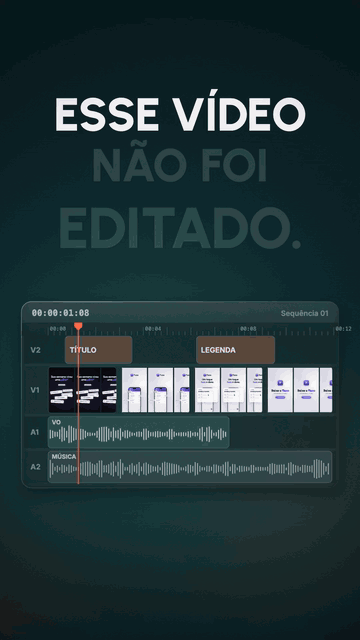

<div align="center">

# Fábrica de Criativos

**Método aberto e reprodutível para produzir anúncios de vídeo vertical em motion design com IA**

[](https://github.com/FilipeMolinariMoura/fabrica-de-criativos/actions/workflows/ci.yml)
[](LICENSE)
[](LICENSE-docs.md)
[](dist/Fabrica-de-Criativos.pdf)



<sub>Este anúncio foi feito com o próprio kit (`exemplos/divulgacao`): glassmorphism, cenas presas às palavras, narração em diálogo com vozes da Fish Audio (modelo gratuito) escolhidas frase a frase pela entonação. [Vídeo em 60 fps na release](https://github.com/FilipeMolinariMoura/fabrica-de-criativos/releases/latest).</sub>

</div>

---

## Resumo

Anúncios em vídeo para Reels, TikTok e Shorts pedem volume, variação e rapidez, mas editores de timeline tornam cada ajuste um retrabalho manual. Este projeto trata o anúncio como **programa**: cada quadro é uma função pura do tempo, renderizada quadro a quadro num navegador sem interface.

As cenas são ancoradas nas **palavras da narração**. Por isso, trocar a voz, a cor ou o estilo gera uma variação nova e ainda sincronizada com um único comando. Cada etapa do método tem uma **trilha gratuita**, com software livre e modelos de pesos abertos, e uma **trilha paga**, com serviços comerciais de estúdio.

> **Abstract (EN).** An open, reproducible method and toolkit for producing vertical (9:16) motion-design video ads with AI. Each frame is a pure function of time, rendered deterministically with Playwright. Scenes are anchored to narration word timestamps, so colour, style and voice variants stay in sync. Every stage has a free path (open-weight models: Qwen3-Coder via Ollama, Kokoro TTS) and a paid path (Claude, ElevenLabs, After Effects). See the [technical report](docs/relatorio-tecnico.md).

## Destaques

- **Determinístico:** o mesmo commit gera o mesmo MP4, então o criativo pode ser versionado no Git.
- **Sincronizado pela fala:** um texto que muda move cenas, efeitos e trilha sozinhos.
- **Entonação controlada frase a frase:** `voz_por_frase.py` gera vários candidatos por frase e fica com o que termina no tom certo; `voz_dialogo.py` monta diálogos entre vozes.
- **Verificação às cegas da voz:** o Whisper transcreve sem ver o roteiro, e o Praat mede a entonação no fim de cada frase.
- **Áudio dentro do padrão:** trilha e efeitos sintetizados em código, master em -14 LUFS / -1 dBTP (ITU-R BS.1770).
- **Biblioteca de motion:** molas, título com desfoque, cards de vidro, pílulas, cursor e toque, celular, transições e cartão final.
- **Duas trilhas:** dá para produzir tudo de graça ou com ferramentas de estúdio, e misturar as duas.
- **Material de estudo:** guia em PDF, relatório técnico no formato de artigo, referências em ABNT e rubrica de crítica.

## Gratuito ou pago

| Etapa | Trilha gratuita | Trilha paga |
|---|---|---|
| Agente (roteiro, código, revisão) | Claude Code + **Ollama** com modelo aberto (`qwen3-coder:30b`, `gpt-oss:20b`), ou OpenCode / Aider | **Claude Code** com plano Claude |
| Narração | **Kokoro-82M** (Apache-2.0, local) ou **Fish Audio** (modelo `s2.1-pro-free`, cota gratuita) | **ElevenLabs** `eleven_v3` (plano Starter ou acima para uso comercial) |
| Conferência da fala | Whisper (mlx-whisper / openai-whisper) | igual |
| Trilha e efeitos | Sintetizados em código | igual |
| Logo 3D | three.js ou Blender | After Effects por script |
| Render | Playwright + ffmpeg | igual |

Detalhes: [trilha gratuita](docs/03-trilha-gratuita.md) · [trilha paga](docs/04-trilha-paga.md).

> Nenhum modelo aberto *é* o Claude. Na trilha gratuita, ele roda dentro da mesma interface de agente. Funciona bem em tarefas curtas; nas longas, peça uma etapa por vez.

## Começo rápido

Pré-requisitos: Node.js 18+, [uv](https://docs.astral.sh/uv/), ffmpeg e Whisper (o `make setup` avisa o que falta).

```bash
git clone https://github.com/FilipeMolinariMoura/fabrica-de-criativos
cd fabrica-de-criativos
make setup          # npm, Chromium do Playwright e conferência das ferramentas
make demo           # voz grátis + trilha + efeitos + mixagem + prévia do exemplo
```

A prévia sai em `entrega/previas/`. Para começar um criativo seu:

```bash
scripts/novo_criativo.sh a01 "Meu primeiro criativo"
```

Depois siga o [método em 8 etapas](docs/01-metodo.md).

### Usando o Claude Code com um modelo aberto (grátis)

```bash
ollama pull qwen3-coder:30b && ollama serve
export ANTHROPIC_BASE_URL=http://localhost:11434 ANTHROPIC_AUTH_TOKEN=ollama ANTHROPIC_API_KEY=""
claude --model qwen3-coder:30b
```

## O método

```
Briefing → Roteiro → Voz → Narração no tempo → Trilha e efeitos → Filme → Crítica → Render e variações
```

| # | Etapa | Ferramenta principal | Saída |
|---|---|---|---|
| 1 | Briefing | `templates/briefing.md` | briefing aprovado |
| 2 | Roteiro | agente + `marketing:content-creation` | `roteiros.json` |
| 3 | Voz | `voz_kokoro.py` / `voz_fish.mjs` / `voz_eleven.mjs`, `voz_por_frase.py` + `voz_avaliar.py` | melhor tomada |
| 4 | Narração no tempo | `vo_montar.py` | `vo.json` (palavras no tempo) |
| 5 | Trilha e efeitos | `trilha.py`, `sfx.mjs`, `mix.mjs` | `mix.wav` em -14 LUFS |
| 6 | Filme | `lib/cena.js` + `lib/motion.js` | `film.js` |
| 7 | Crítica | `render.mjs --contact` + `templates/critica.md` | 3 rodadas, notas ≥ 8 |
| 8 | Render e variações | `finalizar.sh`, `variante.py`, `checar_entrega.sh` | MP4 1080×1920 @ 60 fps |

## Estrutura do repositório

```
fabrica-de-criativos/
├─ docs/              método, ferramentas, trilhas, skills, técnicas, relatório técnico, referências
├─ lib/               motion.js (harness), cena.js (primitivas), marca.json, fonts/ (OFL)
├─ scripts/           voz, avaliação, narração, trilha, variações, finalização, conferência
├─ ae/logo3d/         logo 3D no After Effects controlado por script
├─ exemplos/         demo/ (app fictício) e divulgacao/ (o anúncio do próprio projeto)
├─ templates/         briefing, roteiro, rubrica de crítica, checklist de entrega
├─ vendor/motion-reel motor de render (MIT, v1.3.0)
├─ ebook/  dist/      fonte e PDF do guia "Fábrica de Criativos"
└─ Makefile           setup · demo · voz-gratis · voz-paga · avaliar · previa · final · checar
```

## Documentação

| Documento | Conteúdo |
|---|---|
| [Guia em PDF](dist/Fabrica-de-Criativos.pdf) | O tutorial completo, diagramado (20 páginas) |
| [1. Método](docs/01-metodo.md) | As 8 etapas, entradas, saídas e portões de qualidade |
| [2. Ferramentas](docs/02-ferramentas.md) | Inventário completo, licenças e o que foi descartado |
| [3. Trilha gratuita](docs/03-trilha-gratuita.md) | Ollama, modelos abertos, Kokoro, three.js e Blender |
| [4. Trilha paga](docs/04-trilha-paga.md) | Claude, ElevenLabs, After Effects e orçamento |
| [5. Skills](docs/05-skills.md) | Qual skill ou plugin usar em cada etapa |
| [6. Técnicas de motion](docs/06-tecnicas-de-motion.md) | Fundamentos, receitas e erros comuns |
| [7. Roteiro e copy](docs/07-roteiro-e-copy.md) | Fórmula de 30 s, ganchos, escrita para a voz |
| [8. Qualidade](docs/08-qualidade-e-solucao-de-problemas.md) | Rubrica, especificação de entrega e solução de problemas |
| [Relatório técnico](docs/relatorio-tecnico.md) | Artigo: resumo, fundamentação, método, avaliação, limitações |
| [Referências](docs/referencias.md) | Bibliografia em ABNT |

Gere o PDF de novo com `node ebook/build.mjs`.

## Como citar

```bibtex
@software{molinari_fabrica_de_criativos_2026,
  author  = {Molinari, Filipe},
  title   = {Fábrica de Criativos: método aberto para anúncios em vídeo com motion design e IA},
  year    = {2026},
  version = {1.0.0},
  url     = {https://github.com/FilipeMolinariMoura/fabrica-de-criativos}
}
```

ABNT: MOLINARI, Filipe. **Fábrica de Criativos**: método aberto para anúncios em vídeo com motion design e IA. Versão 1.0.0. 2026. Disponível em: https://github.com/FilipeMolinariMoura/fabrica-de-criativos.

## Ética e licenças de uso

- Use **só a interface real** do produto anunciado e **nenhum número sem fonte**.
- **Voz sintética:** siga as políticas de conteúdo gerado por IA da plataforma. Clonar a voz de alguém exige consentimento.
- **Uso comercial:** o plano gratuito da ElevenLabs não permite. O Kokoro (Apache-2.0) permite. Os pesos do F5-TTS e do XTTS-v2 são não comerciais.
- **Material de cliente:** nunca vai para o repositório. O `.gitignore` já exclui `.env`, áudio, vídeo e projetos do After Effects.

## Licença

- Código: [MIT](LICENSE).
- Documentação e guia: [CC BY 4.0](LICENSE-docs.md).
- Terceiros: `vendor/motion-reel` (MIT, Aries Spring) e fontes Urbanist e Inter (SIL OFL 1.1).

Contribuições: veja [CONTRIBUTING.md](CONTRIBUTING.md).
