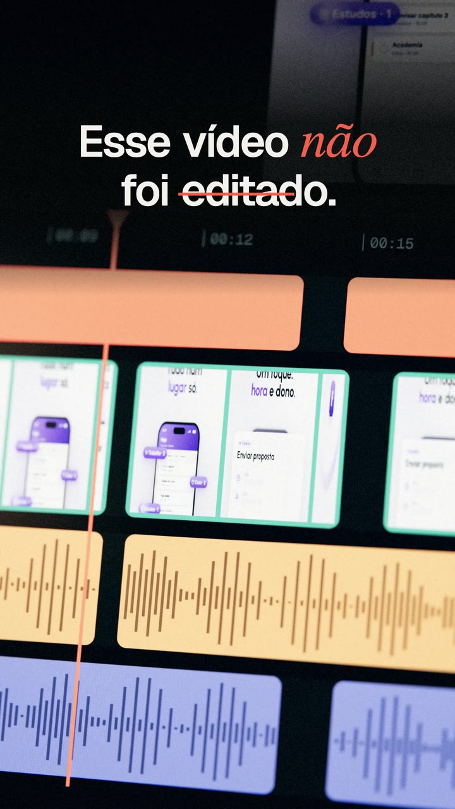
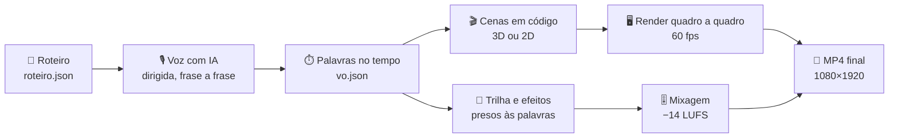

<div align="center">

# Fábrica de Criativos

### Escreva o roteiro. A IA narra. O código filma. E não custa nada.

Anúncios em vídeo vertical com **3D fotorrealista**, **voz por IA** e **cada cena entrando na palavra falada**, gerados a partir de código, em 60 fps, prontos para Reels, TikTok e Shorts.

**100% gratuito e de código aberto.** Sem assinatura, sem editor de vídeo pago, sem marca d'água.

[](#-de-graça-de-ponta-a-ponta)
[](CHANGELOG.md)
[](#-começar-em-10-minutos)
[](https://nodejs.org)
[](https://www.python.org)
[](https://threejs.org)
[](https://github.com/FilipeMolinariMoura/fabrica-de-criativos/actions/workflows/ci.yml)
[](LICENSE)

<a href="https://github.com/FilipeMolinariMoura/fabrica-de-criativos/releases/latest">
  
</a>

**Este anúncio não foi editado. Ele foi programado com este repositório.**<br>
<a href="https://github.com/FilipeMolinariMoura/fabrica-de-criativos/releases/latest"><b>▶ Assistir em 60 fps, com som</b></a> · <a href="dist/Fabrica-de-Criativos.pdf"><b>📘 Guia em PDF</b></a> · <a href="#-começar-em-10-minutos"><b>🚀 Começar agora</b></a>

</div>

---

## ✨ O que é

A Fábrica de Criativos é um **método completo e um kit gratuito de código aberto** para produzir anúncios em vídeo com qualidade de estúdio, sem abrir um editor de vídeo e sem pagar nenhuma ferramenta.

Você descreve o anúncio num arquivo de texto. A ferramenta gera a narração com IA, marca o instante de cada palavra, monta as cenas em 3D com luz, lente e materiais reais, compõe a trilha e os efeitos, mixa no padrão das redes e entrega o MP4 final.

| | |
|---|---|
| 💸 **Custa zero** | Motor, 3D, voz, trilha, efeitos e mixagem rodam no seu computador, com software livre e modelos de IA abertos. |
| 🎬 **Qualidade de filme de produto** | 3D fotorrealista com profundidade de campo real, desfoque de movimento, luz de estúdio e vidro com refração. |
| 🎙️ **Voz por IA, grátis** | Narração com voz aberta rodando no seu computador, ou voz de locutor dirigida se você quiser ir além. |
| ⏱️ **Sincronia perfeita** | Cada corte e cada efeito cai na palavra falada. Mudou o texto? O filme se reorganiza sozinho. |
| 🔁 **Variações em um comando** | Outra cor, outro estilo, outra voz, sem refazer nada. Ideal para teste A/B. |
| 📐 **Pronto para postar** | 1080×1920, 60 fps, H.264 e áudio em −14 LUFS, o padrão das plataformas. |

## 🎞️ Veja o resultado

<table>
<tr>
<td align="center"><br><sub>Gancho</sub></td>
<td align="center"><br><sub>"Ele foi programado"</sub></td>
<td align="center"><br><sub>Cena na palavra</sub></td>
<td align="center"><br><sub>60 fps</sub></td>
<td align="center"><br><sub>"Custa zero"</sub></td>
<td align="center"><br><sub>Chamada final</sub></td>
</tr>
</table>

Tudo o que aparece nesse filme está no repositório: o roteiro, as cenas, a câmera, a luz, os materiais e o som, em [`exemplos/bancada`](exemplos/bancada).

## ⚙️ Como funciona



Cada etapa grava um arquivo que a próxima lê. Por isso dá para trocar só a voz, só a música ou só uma cena, e o resto se ajusta.

---

## 💸 De graça, de ponta a ponta

Todas as etapas têm um caminho **gratuito** que roda no seu computador. Nada de assinatura, créditos ou marca d'água.

| Etapa | 🆓 Como fazer de graça | O que usa |
|---|---|---|
| **Roteiro e cenas com IA** | Agente de IA com um modelo aberto rodando no seu computador | [Ollama](https://ollama.com) + `qwen3-coder` ou `gpt-oss` |
| **Voz** | Voz por IA local, com vozes em português do Brasil | [Kokoro](https://huggingface.co/hexgrad/Kokoro-82M) (Apache-2.0, uso comercial liberado) |
| **Palavras no tempo** | Reconhecedor de fala local | [Whisper](https://github.com/openai/whisper) |
| **Cenas em 3D fotorrealista** | Motor incluído no projeto | [three.js](https://threejs.org) |
| **Trilha e efeitos** | Compostos em código, já presos às palavras | Incluídos |
| **Render, mixagem e entrega** | Quadro a quadro, em 60 fps, −14 LUFS | Chromium + FFmpeg |
| **Total** | | **R$ 0** |

O `npm run demo` usa exatamente esse caminho: voz gratuita, trilha gratuita, render gratuito.

<details>
<summary><b>Usar o agente de IA de graça (Claude Code + modelo aberto)</b></summary>

1. Instale o [Ollama](https://ollama.com/download) e o [Claude Code](https://docs.claude.com/en/docs/claude-code/overview).
2. Baixe um modelo aberto e deixe o Ollama rodando:

```bash
ollama pull qwen3-coder:30b
ollama serve
```

3. Em outro terminal, aponte o Claude Code para o Ollama e abra-o na pasta do projeto.

No macOS e no Linux:

```bash
export ANTHROPIC_BASE_URL=http://localhost:11434 ANTHROPIC_AUTH_TOKEN=ollama ANTHROPIC_API_KEY=""
claude --model qwen3-coder:30b
```

No Windows (PowerShell):

```powershell
$env:ANTHROPIC_BASE_URL="http://localhost:11434"; $env:ANTHROPIC_AUTH_TOKEN="ollama"; $env:ANTHROPIC_API_KEY=""
claude --model qwen3-coder:30b
```

Com 16 GB de memória, use `gpt-oss:20b`. Com 32 GB, `qwen3-coder:30b`. Detalhes em [docs/03-trilha-gratuita.md](docs/03-trilha-gratuita.md).

</details>

### Quer ir além? Serviços pagos são opcionais

Se quiser voz de locutor profissional ou música produzida, troque só a etapa que quiser. O resto continua igual e gratuito.

| Etapa | Opcional pago | Para quê |
|---|---|---|
| Agente de IA | [Claude Code](https://docs.claude.com/en/docs/claude-code/overview) com plano Claude | Mais rapidez em tarefas longas |
| Voz | [ElevenLabs](https://elevenlabs.io) (a partir de US$ 5/mês) ou [Fish Audio](https://fish.audio) (tem cota grátis) | Voz de locutor com direção de tom |
| Música | ElevenLabs Music | Trilha produzida, alinhada à fala |

Guias: [caminho gratuito](docs/03-trilha-gratuita.md) · [serviços opcionais](docs/04-trilha-paga.md).

---

## 🚀 Começar em 10 minutos

São quatro passos. Não precisa saber programar: é copiar e colar.

### 1. Baixe o projeto

Instale o [Git](https://git-scm.com/downloads) se ainda não tiver. Depois abra o terminal e rode:

```bash
git clone https://github.com/FilipeMolinariMoura/fabrica-de-criativos.git
cd fabrica-de-criativos
```

> **Onde fica o terminal?** No Windows, abra o menu Iniciar e procure **PowerShell**. No macOS, procure **Terminal** no Spotlight (⌘ + espaço). No Linux, **Terminal**.

Prefere sem Git? Clique no botão verde **Code → Download ZIP** no topo desta página, descompacte e abra o terminal dentro da pasta.

### 2. Instale tudo com um comando

O instalador coloca no seu computador o que o projeto precisa (Node.js, FFmpeg, uv, o navegador de render e o reconhecedor de fala) e confere se ficou tudo certo. Ele pula o que você já tiver.

<details open>
<summary><b>🪟 Windows 10 e 11</b></summary>

No PowerShell, dentro da pasta do projeto:

```powershell
powershell -ExecutionPolicy Bypass -File instalar\windows.ps1
```

O instalador usa o **winget**, que já vem no Windows 10 e 11. Ao terminar, **feche e abra o PowerShell de novo** para os programas novos aparecerem.

</details>

<details>
<summary><b>🍎 macOS</b></summary>

```bash
bash instalar/macos.sh
```

Usa o [Homebrew](https://brew.sh). Se ele não estiver instalado, o script instala primeiro (vai pedir a senha do Mac).

</details>

<details>
<summary><b>🐧 Linux (Ubuntu, Debian e derivados)</b></summary>

```bash
bash instalar/linux.sh
```

Usa o `apt` e vai pedir a senha de administrador (`sudo`).

</details>

### 3. Confira a instalação

```bash
npm run verificar
```

Você vai ver uma lista com ✔ em cada item. Se aparecer algum ✖, a própria linha diz o que fazer.

### 4. Gere o primeiro vídeo

```bash
npm run demo
```

Em poucos minutos, o projeto cria um anúncio de exemplo do começo ao fim, **sem gastar nada**: voz gratuita, trilha, efeitos e mixagem. O vídeo aparece em:

```
entrega/previas/demo-previa.mp4
```

**Pronto: você acabou de gerar um anúncio a partir de código.** 🎉

### E o filme 3D?

Veja os 16 planos do anúncio em 3D numa folha de quadros, em segundos:

```bash
npm run contato -- exemplos/bancada
```

E renderize a prévia completa do filme em 3D:

```bash
npm run previa -- exemplos/bancada --sem-audio
```

---

## 🎯 Crie o seu anúncio

O caminho mais fácil é usar um agente de IA (como o [Claude Code](https://docs.claude.com/en/docs/claude-code/overview)) dentro da pasta do projeto. Ele lê a documentação e conduz cada etapa. Exemplo de pedido:

> Siga `docs/01-metodo.md`. Meu produto é [descreva]. Escreva o roteiro de 30 s, gere amostras de voz para eu escolher e monte o filme em `criativos/meu-anuncio`.

Se preferir fazer à mão, são estes comandos:

```bash
# 1. Crie a pasta do anúncio a partir do modelo
npm run novo -- meu-anuncio "Meu primeiro anúncio"

# 2. Escreva o roteiro em criativos/meu-anuncio/roteiro.json

# 3. Gere a narração com a voz gratuita
uv run scripts/voz_kokoro.py meu-anuncio pf_dora 3 --roteiros criativos/meu-anuncio/roteiro.json

# 4. Escolha a melhor tomada e marque o tempo de cada palavra
uv run scripts/voz_avaliar.py voz/meu-anuncio
uv run scripts/vo_montar.py criativos/meu-anuncio voz/meu-anuncio/pf_dora-1.wav

# 5. Prévia rápida e versão final
npm run previa -- criativos/meu-anuncio
npm run final -- criativos/meu-anuncio

# 6. Confira se o arquivo está no padrão das redes
npm run checar -- entrega/finais/meu-anuncio.mp4
```

Tudo isso de graça. Se um dia quiser voz de locutor profissional, troque só a voz pela ElevenLabs com direção de tom: [docs/12-voz-dirigida.md](docs/12-voz-dirigida.md).

---

## 🧰 Requisitos e versões

### Sistemas

| Sistema | Versão | Instalação |
|---|---|---|
| 🪟 Windows | 10 (22H2) ou 11 | `instalar\windows.ps1` (winget) |
| 🍎 macOS | 13 Ventura ou mais novo, Intel ou Apple Silicon | `instalar/macos.sh` (Homebrew) |
| 🐧 Linux | Ubuntu 22.04+, Debian 12+ e derivados | `instalar/linux.sh` (apt) |

Desenvolvido e validado em macOS com Apple Silicon. Em qualquer sistema, o `npm run verificar` confirma se o render está usando a placa de vídeo.

### Computador

| | Mínimo | Recomendado |
|---|---|---|
| Memória | 8 GB | 16 GB |
| Placa de vídeo | Qualquer uma com WebGL 2 (a integrada serve) | Placa dedicada ou Apple Silicon |
| Espaço em disco | 5 GB (programas, navegador e modelos de voz e fala) | 10 GB (para guardar vários renders) |

### Linguagens

| Linguagem | Onde é usada |
|---|---|
| **JavaScript** (Node.js, módulos ES) | Cenas, motores 3D e 2D, render, efeitos, mixagem e a linha de comando |
| **Python** | Voz, conferência da fala, trilha musical, folhas de quadros |
| **HTML e CSS** | Página de cada filme e o guia em PDF |
| **Shell** (opcional) | Atalhos `make` para quem usa macOS ou Linux |

### Programas

| Programa | Versão | Para quê |
|---|---|---|
| [Node.js](https://nodejs.org) | 20 LTS ou mais novo (testado no 22) | Roda o motor e o render |
| [npm](https://www.npmjs.com) | vem com o Node.js | Instala as bibliotecas JavaScript |
| [uv](https://docs.astral.sh/uv/) | 0.5 ou mais novo (testado no 0.13) | Roda os scripts Python e **baixa o Python certo sozinho** |
| [FFmpeg](https://ffmpeg.org) | 6 ou mais novo | Codifica o vídeo e mede o áudio |
| [Git](https://git-scm.com) | qualquer recente | Baixa o projeto |
| Chromium do [Playwright](https://playwright.dev) | instalado pelo instalador | Desenha cada quadro na placa de vídeo |
| Reconhecedor de fala | [mlx-whisper](https://github.com/ml-explore/mlx-examples) 0.4 (Mac Apple Silicon) ou [openai-whisper](https://github.com/openai/whisper) (Windows e Linux) | Marca o instante de cada palavra |

Você não precisa instalar o Python à parte: o `uv` baixa a versão que cada script pede (3.10 a 3.12).

### Bibliotecas

| Biblioteca | Versão | Linguagem | Para quê |
|---|---|---|---|
| [three.js](https://threejs.org) | 0.187 | JavaScript | Cenas 3D, materiais e luz |
| [Playwright](https://playwright.dev) | 1.65 | JavaScript | Controla o navegador que renderiza os quadros |
| [motion-reel](vendor/motion-reel) | 1.3 (incluída) | JavaScript e Python | Motor 2D, efeitos sonoros e mixagem |
| [NumPy](https://numpy.org), [SciPy](https://scipy.org) | atuais | Python | Áudio e sinais |
| [librosa](https://librosa.org) | 0.10 ou mais nova | Python | Análise de ritmo da trilha |
| [soundfile](https://github.com/bastibe/python-soundfile) | atual | Python | Leitura e gravação de áudio |
| [Parselmouth (Praat)](https://parselmouth.readthedocs.io) | atual | Python | Mede a entonação no fim das frases |
| [Kokoro](https://huggingface.co/hexgrad/Kokoro-82M) | 0.9.4 ou mais nova | Python | Voz gratuita, local |
| [Pillow](https://python-pillow.org) | atual | Python | Folhas de quadros |

As bibliotecas Python são instaladas sozinhas pelo `uv` na primeira vez que cada script roda.

### Chaves de serviços (opcionais)

O caminho gratuito não precisa de nenhuma chave. Elas só servem se você escolher vozes ou música pagas. Copie `.env.example` para `.env` e preencha:

| Variável | Serviço |
|---|---|
| `ELEVENLABS_API_KEY` | [ElevenLabs](https://elevenlabs.io): voz dirigida e música (opcional) |
| `FISH_API_KEY` | [Fish Audio](https://fish.audio): voz |

O arquivo `.env` nunca vai para o repositório.

---

## 📟 Comandos

Funcionam igual no Windows, no macOS e no Linux.

| Comando | O que faz |
|---|---|
| `npm run verificar` | Confere se tudo está instalado e se a placa de vídeo está sendo usada |
| `npm run demo` | Gera o anúncio de exemplo do começo ao fim |
| `npm run novo -- <id> "<título>"` | Cria a pasta de um anúncio novo |
| `npm run contato -- <pasta>` | Folha com um quadro de cada cena, em segundos |
| `npm run previa -- <pasta>` | Prévia em 30 fps, com som |
| `npm run final -- <pasta>` | Versão final em 60 fps, com som |
| `npm run audio -- <pasta>` | Refaz só a trilha, os efeitos e a mixagem |
| `npm run checar -- <arquivo.mp4>` | Confere resolução, fps, formato e volume |

Na prévia e no final dá para renderizar só um trecho (`--de 10 --ate 15`), mudar a qualidade (`--spp 64`) ou reaproveitar o áudio já mixado sem refazê-lo (`--sem-audio`).

No macOS e no Linux, os mesmos comandos também existem como `make` (`make demo`, `make final3d FILME=exemplos/bancada`). Rode `make ajuda` para ver a lista.

---

## 🗂️ O que vem no repositório

```
fabrica-de-criativos/
├─ fabrica.mjs           linha de comando (npm run …)
├─ instalar/             instaladores para Windows, macOS e Linux
├─ lib/
│  ├─ 3d/                motor 3D fotorrealista (three.js)
│  └─ cena.js            primitivas do motor 2D
├─ scripts/              voz, trilha, montagem da narração, variações, entrega
├─ exemplos/
│  ├─ bancada/           o anúncio 3D desta página
│  ├─ divulgacao/        anúncio em motion 2D com glassmorphism
│  └─ demo/              exemplo rápido de um aplicativo
├─ templates/            briefing, roteiro, crítica, referências, checklist
├─ docs/                 o manual completo (15 capítulos)
├─ dist/                 o guia em PDF
└─ vendor/motion-reel/   motor 2D e de áudio (MIT)
```

## 📚 Documentação

| Para quem | Comece por |
|---|---|
| **Quero só gerar vídeos** | [Começar em 10 minutos](#-começar-em-10-minutos) e [solução de problemas](docs/08-qualidade-e-solucao-de-problemas.md) |
| **Quero aprender o método** | [O método em 10 etapas](docs/01-metodo.md) |
| **Quero o 3D fotorrealista** | [3D fotorrealista](docs/11-3d-fotorrealista.md) e [o making-of de A bancada](docs/14-estudo-de-caso-a-bancada.md) |
| **Quero a melhor voz** | [Voz dirigida](docs/12-voz-dirigida.md) |
| **Quero estudar ou citar** | [Relatório técnico](docs/relatorio-tecnico.md) e [referências](docs/referencias.md) |

O manual completo está em [`docs/`](docs/README.md), e a versão diagramada no [guia em PDF](dist/Fabrica-de-Criativos.pdf).

<details>
<summary><b>O método em 10 etapas</b></summary>

| # | Etapa | Resultado |
|---|---|---|
| 1 | [Briefing](docs/01-metodo.md) | Produto, público, mensagem e chamada definidos |
| 2 | [Referências](docs/09-pesquisa-de-referencias.md) | As regras visuais do anúncio, com números |
| 3 | [Roteiro](docs/07-roteiro-e-copy.md) | 30 segundos escritos para o ouvido, com gancho forte |
| 4 | [Voz dirigida](docs/12-voz-dirigida.md) | Narração com o tom aprovado |
| 5 | [Narração no tempo](docs/01-metodo.md) | O instante exato de cada palavra |
| 6 | [Look-dev](docs/10-look-dev.md) | Quadros de estilo aprovados antes de construir |
| 7 | [Filme](docs/11-3d-fotorrealista.md) | As cenas, cada corte preso a uma palavra |
| 8 | [Som](docs/13-som.md) | Trilha, efeitos e mixagem em −14 LUFS |
| 9 | [Crítica independente](docs/08-qualidade-e-solucao-de-problemas.md) | Ajustes guiados por medição |
| 10 | [Entrega](docs/08-qualidade-e-solucao-de-problemas.md) | MP4 em 60 fps e variações |

</details>

---

## ❓ Perguntas frequentes

<details>
<summary><b>Preciso saber programar?</b></summary>

Não para gerar vídeos: os comandos desta página bastam. Para criar cenas novas, o mais prático é pedir a um agente de IA, que escreve o código seguindo a documentação.

</details>

<details>
<summary><b>É grátis mesmo?</b></summary>

Sim. Do roteiro ao MP4 final, tudo pode rodar no seu computador com software livre e modelos de IA abertos: Ollama para o agente, Kokoro para a voz, Whisper para marcar as palavras, three.js para o 3D, FFmpeg para o vídeo. Não tem assinatura, limite de vídeos nem marca d'água. Serviços pagos, como a ElevenLabs, são opcionais.

</details>

<details>
<summary><b>Funciona no Windows?</b></summary>

Sim. Use o instalador `instalar\windows.ps1` e os comandos `npm run`. Eles são os mesmos nos três sistemas.

</details>

<details>
<summary><b>Preciso de uma placa de vídeo potente?</b></summary>

Não. Qualquer placa com WebGL 2, inclusive as integradas, renderiza o filme. Uma placa melhor só deixa o render final mais rápido. Num MacBook com M1 Pro, os 35 segundos de A bancada em 60 fps levam cerca de 40 minutos.

</details>

<details>
<summary><b>Por que não usar uma IA que gera o vídeo direto?</b></summary>

Porque aqui você tem controle total: a interface real do produto aparece como ela é, cada cena cai na palavra certa, e qualquer ajuste é refeito com precisão. O mesmo código gera sempre o mesmo vídeo.

</details>

<details>
<summary><b>Posso usar nos anúncios dos meus clientes?</b></summary>

Sim, e de graça. O código é MIT e a voz Kokoro é Apache-2.0: os dois permitem uso comercial. Se escolher um serviço pago de voz ou música, confira a licença do plano.

</details>

<details>
<summary><b>Funciona com outros agentes de IA além do Claude?</b></summary>

Sim. A documentação é em texto e os comandos são de terminal, então qualquer agente que lê arquivos e roda comandos consegue conduzir o método.

</details>

<details>
<summary><b>Quanto tempo leva para fazer um anúncio?</b></summary>

Com o método dominado, de uma a duas horas de trabalho por anúncio, mais o tempo de render. As variações (cor, estilo e voz) saem em minutos.

</details>

---

## 🤝 Contribua

Ideias, cenas novas, vozes em outros idiomas e melhorias são muito bem-vindas. Leia o [guia de contribuição](CONTRIBUTING.md) e abra uma [issue](https://github.com/FilipeMolinariMoura/fabrica-de-criativos/issues).

Fez um anúncio com a Fábrica? Mostre em [Issues → Mostrar um criativo](https://github.com/FilipeMolinariMoura/fabrica-de-criativos/issues/new/choose).

Se o projeto te ajudou, deixe uma ⭐. Isso ajuda mais gente a encontrá-lo.

## 📄 Licença

- **Código:** [MIT](LICENSE). Grátis para usar, modificar e usar comercialmente.
- **Documentação e guia:** [CC BY 4.0](LICENSE-docs.md).
- **Componentes de terceiros:** motion-reel (MIT), fontes Inter, Urbanist, Geist e Instrument Serif (SIL OFL 1.1), texturas e HDRI da Poly Haven e da ambientCG (CC0). Detalhes em [`lib/3d/assets/ASSETS.md`](lib/3d/assets/ASSETS.md).

## 📝 Como citar

```bibtex
@software{molinari_fabrica_de_criativos_2026,
  author  = {Molinari, Filipe},
  title   = {Fábrica de Criativos: anúncios em vídeo a partir de código, com 3D fotorrealista e IA},
  year    = {2026},
  version = {2.1.0},
  url     = {https://github.com/FilipeMolinariMoura/fabrica-de-criativos}
}
```

<div align="center">

Feito por **[Filipe Molinari](https://github.com/FilipeMolinariMoura)** · O anúncio do topo foi produzido com o próprio método.

</div>
