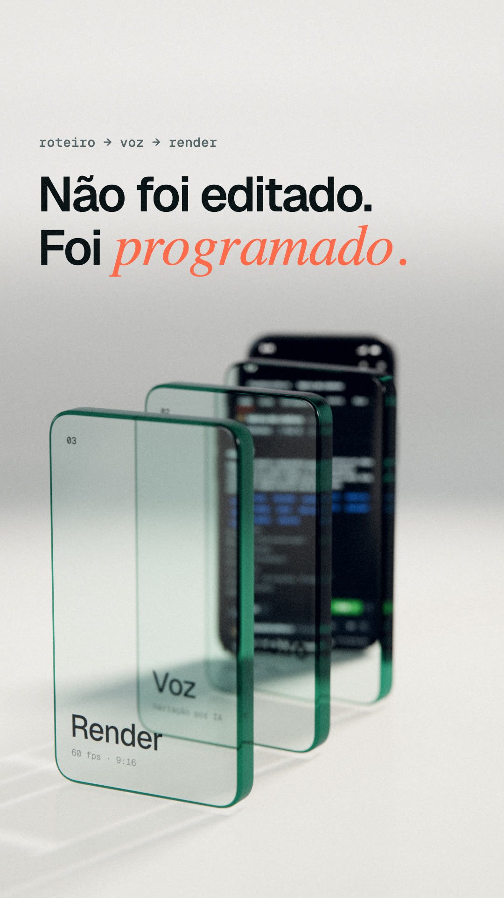
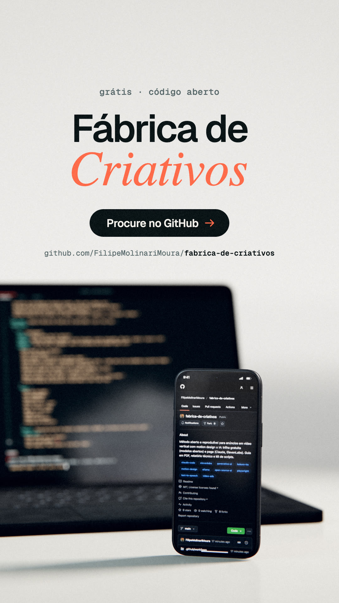

# 10. Look-dev: aprovar a aparência antes de construir

[← 9. Pesquisa de referências](09-pesquisa-de-referencias.md) · [Índice](README.md) · Próximo: [11. 3D fotorrealista →](11-3d-fotorrealista.md)

Look-dev é abreviação de *look development*: desenvolver a aparência. Em vez de construir 30 segundos e descobrir no fim que ficou cru, você constrói quatro quadros e descobre no começo.

É a etapa 6 do método. Custa pouco, e é o lugar mais barato para errar.

## 10.1 O que entregar

| Entrega | Quantidade | Para quê |
|---|---|---|
| **Quadros de estilo** | 3 ou 4, em qualidade final | Um por mundo de luz, um do plano mais difícil e um do cartão final |
| **Teste de movimento** | 1, de 4 segundos | Quadro parado perdoa o que o movimento denuncia |
| **Nota de realismo** | 1 por quadro, de 1 a 10 | Dizer a verdade antes que outra pessoa diga |
| **Lista do que parece falso** | 1 | O plano de trabalho das próximas rodadas |
| **Tempos de render** | 1 tabela | Saber quanto o filme inteiro vai custar |

O filme só começa depois que alguém aprova os quadros. A ficha em branco para preencher é [`templates/quadros-de-estilo.md`](../templates/quadros-de-estilo.md).

## 10.2 Os quatro quadros deste projeto

<table>
<tr>
<td align="center" width="25%"><br><sub><b>A · celular, mundo escuro</b><br>85 mm, f/4 · nota 8</sub></td>
<td align="center" width="25%"><br><sub><b>B · macro, mundo escuro</b><br>100 mm, f/4 · nota 8</sub></td>
<td align="center" width="25%"><br><sub><b>C · vidro, mundo claro</b><br>nota 7</sub></td>
<td align="center" width="25%"><br><sub><b>D · cartão final, mundo claro</b><br>f/3,2 · nota 7</sub></td>
</tr>
</table>

Os quadros foram renderizados a 768 amostras por quadro. O teste de movimento foi o plano A: 4 segundos a 30 fps, empurrão de câmera em 85 mm com troca de foco do notebook para o celular, a 256 amostras.

## 10.3 A nota honesta

A régua foi escrita antes de dar as notas:

- **10:** indistinguível de fotografia de produto de estúdio.
- **5:** render bonito que qualquer pessoa reconhece como 3D.
- O filme 2D reprovado não entra nesta escala.

| Quadro | Nota | Por que não é mais |
|---|---|---|
| A · celular (escuro) | **8** | Passa por foto à primeira vista: foco, madeira, digitais e recorte convencem. Perde no fundo confuso e na moldura lisa demais |
| B · macro (escuro) | **8** | O mais convincente: plano de foco oblíquo, reflexo âmbar manchado, teclas derretidas no desfoque. Perde por não ter estrutura de pixel na tela e pelas teclas genéricas |
| C · vidro (claro) | **7** | Lê como vidro grosso (aresta verde, refração em camadas, sombra no chão). Cáustica pintada, aresta lisa e chão sem textura denunciam o render para quem olha com calma |
| D · cartão final (claro) | **7** | Tipografia e aparelhos seguram o quadro. O mundo claro perdoa menos: falta a luz rebatida do chão nos aparelhos |

Média de 7,5. A conclusão do look-dev, antes de existir o filme, foi: **o mundo escuro está mais perto da meta que o claro, e é no claro que a próxima rodada deve ser gasta.** Os críticos independentes chegaram à mesma conclusão sobre o filme pronto, e o realismo do mundo claro foi o único critério que fechou abaixo de 8. O look-dev previu o ponto fraco do filme.

Como dar nota honesta:

1. Escreva a régua antes.
2. Para cada quadro, escreva o que denuncia o render. Se você não acha nada, olhe em tamanho real por mais um minuto.
3. Dê a nota depois de escrever os defeitos, nunca antes.
4. Não arredonde para cima para fechar a etapa.

## 10.4 O que fez os quadros parecerem fotografia

Em ordem de peso no resultado.

| # | O que | Por que pesa |
|---|---|---|
| 1 | **Profundidade de campo por acumulação, não por pós-processamento** | Lente fina de verdade: a borda do celular, vidro atrás de vidro e o reflexo no chão desfocam certo sem tratamento especial |
| 2 | **Pretos de verdade** | O fundo escuro emite quase nada. Percentil 5 de luminância medido: 6/255 no quadro A e 4/255 no B. O filme reprovado estava em 23 |
| 3 | **Especular só do ambiente em tudo que é liso** | Uma luz que se move dentro da própria área imprime um pontinho por amostra num vidro. Vidro e polidos recebem das luzes só o difuso e a sombra |
| 4 | **Um softbox por plano, posicionado por cálculo** | Em vez de girar o HDRI até dar sorte, calcula-se a direção que o vidro da tela espelha para a câmera daquele plano e põe-se um cartão de luz ali. É a faixa de luz no canto da tela |
| 5 | **Digitais** | Um mapa de rugosidade (escaneamento real, CC0) sobre o vidro. Só aparece onde há reflexo. É o detalhe que mais "vira foto" |
| 6 | **Chão com reflexo renderizado** | Uma segunda câmera espelhada por amostra. O reflexo endurece perto do contato e amolece longe, como num tampo acetinado |
| 7 | **Vidro com aresta própria** | A face é quase incolor; a aresta e o chanfro usam outro material, com absorção forte. Sem isso, a placa parece acrílico leitoso |
| 8 | **Bloom só de emissivos** | Um passe separado, só com as telas. No mundo claro, um bloom por limiar faria o fundo inteiro brilhar |
| 9 | **Lente longa e diafragma fechado o bastante** | 85 mm nos planos de produto, 100 mm no macro. f/2,8 no celular deixava só uma faixa de texto legível; f/4 resolveu |
| 10 | **Acabamento contido** | Grão de 4,2% no escuro e 3,4% no claro, vinheta de 17% e 13%, aberração mínima nos cantos, saturação 8% abaixo |
| 11 | **Cada material com a sua dose do estúdio** | O chão não recebe luz ambiente; o vidro do notebook recebe pouco; o metal recebe metade no mundo claro |

A explicação técnica de cada item está no [capítulo 11](11-3d-fotorrealista.md).

## 10.5 O que ainda parece falso

Esta lista foi escrita no fim do look-dev e continua valendo para o filme.

| Defeito | Causa | Conserto possível |
|---|---|---|
| **Sem luz rebatida nem cáusticas** | É rasterização: a luz não rebate do chão claro para a parte de baixo dos objetos, e o vidro não concentra luz | Traçado de caminhos só nos planos de vidro, ou sombras assadas num programa de 3D |
| **Aresta do vidro uniforme** | Faixa lisa, sem as reflexões internas de uma aresta polida | Gradiente por Fresnel e listras do ambiente na aresta |
| **Refração em espaço de tela** | A transmissão desloca a imagem do que está atrás; não há reflexão interna total | Aguenta o quadro parado; evite órbitas grandes em volta de vidro |
| **Luz ambiente sem oclusão** | O HDRI ilumina o fundo do teclado como se nada estivesse na frente | Oclusão de ambiente só no termo de ambiente |
| **Ciclorama liso demais** | O chão claro é uma cor com ruído | Textura de papel ou tinta, sombras mais longas |
| **Aparelhos limpos demais** | Sem grade de alto-falante, porta, parafuso, poeira ou desgaste | Mais detalhe de modelagem e mapas de imperfeição |
| **Digitais são uma palma inteira** | O mapa escaneado é de mão aberta | Um mapa de toques e arrastos de polegar |
| **Bokeh perfeito demais** | Disco uniforme e redondo | O filme final já deforma o disco perto das bordas do quadro ("olho de gato") |

O filme atacou três desses pontos (foco de luz no chão claro, fibra de papel, sombra de contato por objeto). O primeiro, a luz rebatida, é o que segura o mundo claro em 7,5.

## 10.6 As rodadas

O look-dev levou nove rodadas até a aprovação. As notas de trabalho registram os oito achados abaixo, em ordem.

| Achado | O que se viu | O que se fez |
|---|---|---|
| 1 | Fundo leitoso, bolas de bokeh demais, chão cinza | Escureceu tudo; poucos pontos de luz; sem especular direto no chão |
| 2 | Reflexo na tela dependia de sorte | Ambiente por plano, com softbox calculado |
| 3 | Faltava direção de arte | Dois mundos, duas famílias de fonte, madeira, digitais, bloom só de emissivos, vidro em camadas. O celular passou a ocupar perto de 58% da largura |
| 4 | Vidro parecia acrílico | Aresta própria, f/4 no herói, macro oblíquo com luz âmbar |
| 5 | Sombras do mundo claro sumiam | Câmera mais alta e luz em três quartos de trás; recomposição para o texto não encostar nos objetos |
| 6 | "Névoa" branca no notebook | Era o mapa de digitais forte demais e o especular direto nas teclas |
| 7 | Um clarão branco sobrava na tela | Era um softbox do HDRI. A intensidade de ambiente por material não valia nada do jeito que estava sendo passada. Com a dose certa por material, as sombras do mundo claro finalmente apareceram |
| 8 | — | Finais a 768 amostras, medição dos pretos, teste de movimento |

O achado 7 custou três rodadas de procura. Está na lista de tropeços do [capítulo 11](11-3d-fotorrealista.md#116-tropeços).

## 10.7 Quanto custa um quadro

Medido num Apple M1 Pro com 16 GB, Chromium em modo sem interface, 1080×1920.

| Plano | Prévia (16 spp) | Movimento (192 spp) | Foto (768 spp) |
|---|---|---|---|
| A · celular (escuro) | 0,06 s | 0,68 s | 2,78 s |
| B · macro (escuro) | 0,12 s | 0,58 s | 2,09 s |
| C · vidro (claro) | 0,52 s | 4,55 s | 18,36 s |
| D · cartão final (claro) | 0,06 s | 0,54 s | 2,05 s |

O plano de vidro custa umas oito vezes mais, porque cada amostra passa quatro vezes pela cena (três camadas de vidro e o espelho do chão). A conta ajudou a decidir o filme: pouco vidro com transmissão, e só onde ele conta a história.

## 10.8 Como fazer o seu

1. Parta de `exemplos/bancada`. Ele já monta o estúdio e a câmera.
2. Escolha os instantes dos quadros e renderize em qualidade alta:
   ```bash
   node lib/3d/render.mjs --film exemplos/bancada --at 2.6,10.5,21.4,33 --spp 768
   ```
3. Meça o preto dos quadros escuros (percentil 5 de luminância) e o pico dos claros.
4. Escreva a régua, os defeitos e as notas.
5. Renderize 4 segundos em movimento:
   ```bash
   node lib/3d/render.mjs --film exemplos/bancada --range 0:4 --fps 30 --spp 256 --mp4 out/teste-movimento.mp4
   ```
6. Mostre os quadros e o teste a quem vai aprovar. Não comece o filme antes disso.

## 10.9 Checklist da etapa

- [ ] Um quadro por mundo de luz, mais o cartão final
- [ ] Teste de movimento de 4 s
- [ ] Régua escrita antes das notas
- [ ] Nota e lista de defeitos por quadro
- [ ] Pretos medidos
- [ ] Tabela de tempo de render
- [ ] Aprovação de quem pediu

---

Próximo: [11. 3D fotorrealista →](11-3d-fotorrealista.md)
