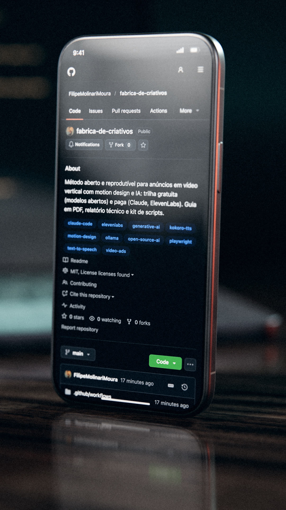
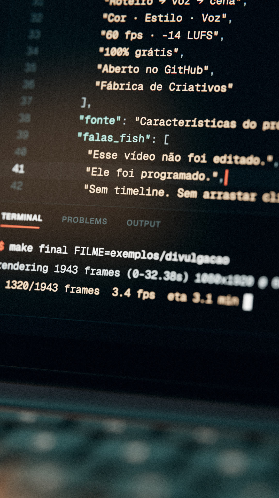

# 10. Look-dev: aprovar a aparência antes de construir

[← 9. Pesquisa de referências](09-pesquisa-de-referencias.md) · [Índice](README.md) · Próximo: [11. 3D fotorrealista →](11-3d-fotorrealista.md)

Look-dev é abreviação de *look development*: desenvolver a aparência. Em vez de construir 30 segundos para só então ver o resultado, você constrói quatro quadros e acerta a aparência logo no começo.

É a etapa 6 do método, e a que mais economiza tempo: cada decisão de luz, lente e material tomada aqui vale para o filme inteiro, e ajustar quatro quadros é muito mais rápido que ajustar trinta segundos.

## 10.1 O que entregar

| Entrega | Quantidade | Para quê |
|---|---|---|
| **Quadros de estilo** | 3 ou 4, em qualidade final | Um por mundo de luz, um do plano mais difícil e um do cartão final |
| **Teste de movimento** | 1, de 4 segundos | Quadro parado perdoa o que o movimento denuncia |
| **Avaliação de realismo** | 1 por quadro, de 1 a 10 | Medir a distância até a referência com uma régua fixa |
| **Lista de refinamentos** | 1 | O plano de trabalho das próximas rodadas |
| **Tempos de render** | 1 tabela | Saber quanto o filme inteiro vai custar |

O filme só começa depois que alguém aprova os quadros. A ficha em branco para preencher é [`templates/quadros-de-estilo.md`](../templates/quadros-de-estilo.md).

## 10.2 Os quatro quadros deste projeto

<table>
<tr>
<td align="center" width="25%"><br><sub><b>A · celular, mundo escuro</b><br>85 mm, f/4</sub></td>
<td align="center" width="25%"><br><sub><b>B · macro, mundo escuro</b><br>100 mm, f/4</sub></td>
<td align="center" width="25%"><br><sub><b>C · vidro, mundo claro</b><br>placas de vidro maciço</sub></td>
<td align="center" width="25%"><br><sub><b>D · cartão final, mundo claro</b><br>f/3,2</sub></td>
</tr>
</table>

Os quadros foram renderizados a 768 amostras por quadro. O teste de movimento foi o plano A: 4 segundos a 30 fps, empurrão de câmera em 85 mm com troca de foco do notebook para o celular, a 256 amostras.

## 10.3 Avaliar com uma régua

Uma avaliação só ajuda quando a régua vem antes do quadro. Escreva-a assim:

- **10:** indistinguível de fotografia de produto de estúdio.
- **5:** render bonito que qualquer pessoa reconhece como 3D.

E descreva cada quadro pelo que ele faz bem e pelo que ainda pode ganhar. Nos quadros deste projeto:

| Quadro | O que vende o quadro | Onde refinar |
|---|---|---|
| A · celular (escuro) | Passa por foto à primeira vista: foco, madeira, digitais e recorte convencem | Fundo mais simples e moldura com mais detalhe |
| B · macro (escuro) | Plano de foco oblíquo, reflexo âmbar manchado, teclas derretidas no desfoque | Estrutura de pixel na tela e teclas mais detalhadas |
| C · vidro (claro) | Lê como vidro grosso: aresta verde, refração em camadas, sombra no chão | Cáustica, aresta polida e textura no chão |
| D · cartão final (claro) | Tipografia e aparelhos seguram o quadro | Luz rebatida do chão nos aparelhos |

A leitura conjunta já orienta o filme: **o mundo escuro chega mais rápido ao fotorrealismo, e o mundo claro é onde vale investir as rodadas de refinamento.** É o tipo de conclusão que o look-dev entrega antes de existir um único segundo de filme.

Boas práticas de avaliação:

1. Escreva a régua antes de olhar os quadros.
2. Para cada quadro, liste o que o aproxima da fotografia e o que o afasta. Olhe em tamanho real, com calma.
3. Dê a nota depois da lista, nunca antes.
4. Peça uma segunda avaliação a quem não construiu os quadros: um olhar independente vê o que o construtor já não enxerga.

## 10.4 O que fez os quadros parecerem fotografia

Em ordem de peso no resultado.

| # | O que | Por que pesa |
|---|---|---|
| 1 | **Profundidade de campo por acumulação, não por pós-processamento** | Lente fina de verdade: a borda do celular, vidro atrás de vidro e o reflexo no chão desfocam certo sem tratamento especial |
| 2 | **Pretos de verdade** | O fundo escuro emite quase nada. Percentil 5 de luminância medido: 6/255 no quadro A e 4/255 no B, dentro da meta de ≤ 8/255 |
| 3 | **Especular só do ambiente em tudo que é liso** | Uma luz que se move dentro da própria área imprime um pontinho por amostra num vidro. Vidro e polidos recebem das luzes só o difuso e a sombra |
| 4 | **Um softbox por plano, posicionado por cálculo** | Em vez de girar o HDRI até dar sorte, calcula-se a direção que o vidro da tela espelha para a câmera daquele plano e põe-se um cartão de luz ali. É a faixa de luz no canto da tela |
| 5 | **Digitais** | Um mapa de rugosidade (escaneamento real, CC0) sobre o vidro. Só aparece onde há reflexo. É o detalhe que mais "vira foto" |
| 6 | **Chão com reflexo renderizado** | Uma segunda câmera espelhada por amostra. O reflexo endurece perto do contato e amolece longe, como num tampo acetinado |
| 7 | **Vidro com aresta própria** | A face é quase incolor; a aresta e o chanfro usam outro material, com absorção forte. Sem isso, a placa parece acrílico leitoso |
| 8 | **Bloom só de emissivos** | Um passe separado, só com as telas. No mundo claro, um bloom por limiar faria o fundo inteiro brilhar |
| 9 | **Lente longa e diafragma fechado o bastante** | 85 mm nos planos de produto, 100 mm no macro. f/4 no celular mantém várias linhas de texto legíveis, com o fundo ainda bem desfocado |
| 10 | **Acabamento contido** | Grão de 4,2% no escuro e 3,4% no claro, vinheta de 17% e 13%, aberração mínima nos cantos, saturação 8% abaixo |
| 11 | **Cada material com a sua dose do estúdio** | O chão não recebe luz ambiente; o vidro do notebook recebe pouco; o metal recebe metade no mundo claro |

A explicação técnica de cada item está no [capítulo 11](11-3d-fotorrealista.md).

## 10.5 Para ir além: refinamentos de realismo

O motor 3D do kit é rasterizado na GPU, o que o torna rápido o bastante para 60 fps com profundidade de campo e desfoque de movimento reais. Para quem quer empurrar o realismo ainda mais, especialmente no mundo claro, estes são os refinamentos com maior retorno:

| Refinamento | O que acrescenta | Como fazer |
|---|---|---|
| **Luz rebatida e cáusticas** | A luz do chão claro sobe para a parte de baixo dos objetos, e o vidro concentra luz | Traçado de caminhos só nos planos de vidro, ou sombras assadas num programa de 3D |
| **Aresta de vidro polida** | Reflexões internas na faixa da aresta | Gradiente por Fresnel e listras do ambiente na aresta |
| **Refração com profundidade** | Vidro convincente também em órbitas longas | A refração em espaço de tela segura muito bem planos parados e movimentos curtos; prefira esses em volta de vidro |
| **Oclusão de ambiente** | Fundo do teclado e frestas mais escuros | Oclusão aplicada só no termo de ambiente |
| **Ciclorama com textura** | Chão claro com matéria | Textura de papel ou tinta, sombras mais longas |
| **Aparelhos com desgaste** | Grade de alto-falante, porta, parafuso, poeira | Mais detalhe de modelagem e mapas de imperfeição |
| **Digitais de uso** | Marcas de toque e arrasto em vez de palma inteira | Um mapa de toques e arrastos de polegar |
| **Bokeh com caráter** | Disco que se deforma perto das bordas | O filme final já aplica o "olho de gato" nas bordas do quadro |

O filme da bancada já incorpora três refinamentos no mundo claro: foco de luz no chão, fibra de papel e sombra de contato por objeto.

## 10.6 Diagnóstico rápido: sintoma e ajuste

Os sintomas mais comuns do look-dev e o ajuste de cada um. Use a tabela como lista de conferência a cada rodada.

| Sintoma | Ajuste |
|---|---|
| Fundo leitoso, bolas de bokeh demais, chão cinza | Escureça o estúdio; poucos pontos de luz; sem especular direto no chão |
| Reflexo na tela imprevisível | Ambiente por plano, com softbox calculado |
| Quadro bonito, mas sem direção de arte | Dois mundos, duas famílias de fonte, madeira, digitais, bloom só de emissivos, vidro em camadas. O herói ocupa perto de 58% da largura |
| Vidro com cara de acrílico | Aresta própria, f/4 no herói, macro oblíquo com luz âmbar |
| Sombras fracas no mundo claro | Câmera mais alta e luz em três quartos de trás; recomponha para o texto não encostar nos objetos |
| "Névoa" branca no notebook | Mapa de digitais mais suave e sem especular direto nas teclas |
| Clarão branco na tela | É um softbox do HDRI refletido. Passe a intensidade de ambiente por material (veja o [capítulo 11](11-3d-fotorrealista.md#116-armadilhas-conhecidas-e-como-evitar)); com a dose certa, as sombras do mundo claro aparecem |
| Pronto para aprovar | Finais a 768 amostras, medição dos pretos, teste de movimento |

## 10.7 Quanto custa um quadro

Medido num Apple M1 Pro com 16 GB, Chromium em modo sem interface, 1080×1920.

| Plano | Prévia (16 spp) | Movimento (192 spp) | Foto (768 spp) |
|---|---|---|---|
| A · celular (escuro) | 0,06 s | 0,68 s | 2,78 s |
| B · macro (escuro) | 0,12 s | 0,58 s | 2,09 s |
| C · vidro (claro) | 0,52 s | 4,55 s | 18,36 s |
| D · cartão final (claro) | 0,06 s | 0,54 s | 2,05 s |

O plano de vidro custa umas oito vezes mais, porque cada amostra passa quatro vezes pela cena (três camadas de vidro e o espelho do chão). A conta ajudou a decidir o filme: pouco vidro com transmissão, e só onde ele conta a história.

## 10.8 Como fazer o seu

1. Parta de `exemplos/bancada`. Ele já monta o estúdio e a câmera.
2. Escolha os instantes dos quadros e renderize em qualidade alta:
   ```bash
   node lib/3d/render.mjs --film exemplos/bancada --at 2.6,10.5,21.4,33 --spp 768
   ```
3. Meça o preto dos quadros escuros (percentil 5 de luminância) e o pico dos claros.
4. Escreva a régua e avalie cada quadro: pontos fortes, refinamentos e nota.
5. Renderize 4 segundos em movimento:
   ```bash
   node lib/3d/render.mjs --film exemplos/bancada --range 0:4 --fps 30 --spp 256 --mp4 out/teste-movimento.mp4
   ```
6. Mostre os quadros e o teste a quem vai aprovar. Não comece o filme antes disso.

## 10.9 Checklist da etapa

- [ ] Um quadro por mundo de luz, mais o cartão final
- [ ] Teste de movimento de 4 s
- [ ] Régua escrita antes da avaliação
- [ ] Avaliação e lista de refinamentos por quadro
- [ ] Segunda avaliação independente
- [ ] Pretos medidos
- [ ] Tabela de tempo de render
- [ ] Aprovação de quem pediu

---

Próximo: [11. 3D fotorrealista →](11-3d-fotorrealista.md)
