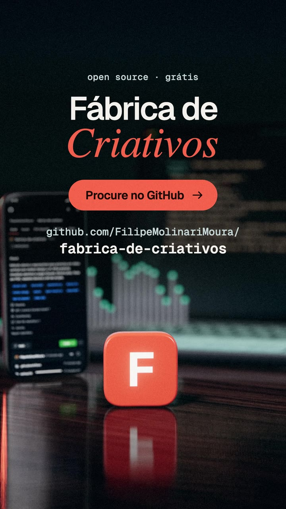

# 14. Estudo de caso: A bancada

[← 13. Som](13-som.md) · [Índice](README.md) · Depois: [Relatório técnico →](relatorio-tecnico.md)

Este é o making-of do anúncio do próprio projeto, na versão 2.0. O método inteiro, aplicado a um caso, com o que deu certo, o que foi recusado e o que continua fraco.

O código está em [`exemplos/bancada/`](../exemplos/bancada/). O vídeo final está na [página de versões do repositório](https://github.com/FilipeMolinariMoura/fabrica-de-criativos/releases/latest).

<table>
<tr>
<td align="center"><br><sub>1a · gancho</sub></td>
<td align="center"><br><sub>1b · virada</sub></td>
<td align="center"><br><sub>6 · palavra falada</sub></td>
<td align="center"><br><sub>10 · custa zero</sub></td>
<td align="center"><br><sub>12b · cartão final</sub></td>
</tr>
</table>

## 14.1 Ficha

| | |
|---|---|
| **Filme** | A bancada |
| **Duração** | 35 s (narração de 32,8 s e 2,2 s de cartão final) |
| **Formato** | 1080×1920, 60 fps, H.264 |
| **Planos** | 16, com cortes secos |
| **Mundos de luz** | Escuro → claro cor de osso → escuro |
| **Motor** | `lib/3d` (three.js, WebGL) |
| **Amostras por quadro** | 192 no final, 128 na prévia |
| **Render final** | 2.100 quadros, de 35 a 40 minutos num Apple M1 Pro |
| **Voz** | ElevenLabs dirigida: voz 1 nas onze primeiras frases, voz 2 nas duas últimas |
| **Som** | Trilha e efeitos sintetizados; −14,0 LUFS, pico −1,3 dBTP |
| **Material de terceiros** | Um HDRI, uma textura de madeira e um mapa de digitais (CC0); três fontes (OFL). Nenhum modelo 3D de terceiros |

## 14.2 Do filme reprovado ao tratamento

1. **A reprovação.** O anúncio em 2D da versão 1.1 foi reprovado pelo autor como "cru".
2. **A medição.** Conteúdo em 3% a 21% do quadro, preto em 23/255, zero corte seco em 32 s ([capítulo 9](09-pesquisa-de-referencias.md#94-análise-de-lacunas)).
3. **As referências.** Dezessete entradas e 12 regras com números.
4. **O tratamento.** Uma frase: *o filme se passa num estúdio de produto, sobre uma bancada, e tudo o que o roteiro cita vira objeto físico.*
5. **O roteiro.** Gancho mantido, meio reescrito: de 84 para 78 palavras ([capítulo 7](07-roteiro-e-copy.md#73-antes-e-depois-o-roteiro-deste-anúncio)).
6. **O look-dev.** Quatro quadros e um teste de movimento, nove rodadas, média de realismo 7,5 ([capítulo 10](10-look-dev.md)).
7. **A voz.** Quatro tentativas, uma aprovada ([capítulo 12](12-voz-dirigida.md)).
8. **O filme, os críticos e as correções.** Este capítulo.

Cada ideia do roteiro virou um objeto:

| O roteiro diz | A bancada mostra |
|---|---|
| "não foi editado" | Um editor de vídeo em macro, com a timeline cheia |
| "foi programado" | A mesma tela: a timeline achata e vira as linhas do roteiro em código |
| "ninguém abriu um editor" | A tampa do notebook cai e quica |
| "ninguém arrastou um clipe" | Clipes de vidro saem sozinhos dos trilhos |
| "você escreve o roteiro" | A linha real do roteiro digitada no ritmo da fala |
| "a inteligência artificial narra" | Uma régua de pinos metálicos movida pelo volume real da narração |
| "cada cena entra na palavra falada" | Sete fichas, uma por palavra; cada uma acende na sua palavra e troca a cena do celular |
| "outra cor, outro estilo, outra voz" | O mesmo enquadramento em três cortes secos |
| "um comando só" | A tecla Enter em macro |
| "sessenta quadros por segundo" | O celular gira com desfoque de movimento e trava nítido |
| "custa zero" | Uma alavanca estala de "pago" para "grátis" |
| "o guia em PDF e o código" | O guia impresso, com páginas reais, e a página real do repositório |

## 14.3 Lista de planos

Cada corte acontece dois quadros antes da palavra indicada. Os tempos vêm do `vo.json` da narração aprovada.

| Plano | Entra em | Palavra do corte | Mundo | Lente | O que acontece | Legenda |
|---|---|---|---|---|---|---|
| 1a | 0,00 s | (quadro 0) | escuro | 100 mm, f/4 | Macro de um editor de vídeo; um clipe é arrastado e encaixa; "editado" é riscado | Esse vídeo *não* foi editado. |
| 1b | 2,38 s | "Ele" | escuro | 100 mm, f/4 | Mesma tomada: a câmera gira e a timeline achata em linhas do roteiro, cravando em "programado" | Ele foi *programado.* |
| 2 | 3,95 s | "Ninguém" | escuro | 50 mm, f/4 | A tampa do notebook cai e quica em "editor" | Ninguém abriu um *editor.* |
| 3 | 5,67 s | "Ninguém" | escuro | 100 mm, f/2,8 | Clipes de vidro saem dos trilhos; o último varre a lente | Ninguém arrastou um *clipe.* |
| 4 | 7,07 s | "Você" | claro | 85 mm, f/5,6 | Notebook no ciclorama digita a linha real do roteiro, palavra a palavra | Você escreve o *roteiro.* |
| 5 | 8,55 s | "a" | claro | 100 mm, f/2,8 | Régua de pinos movida pela envoltória real da narração; a cor da ponta indica a voz | A IA *narra.* |
| 6 | 10,77 s | "cada" | claro | 85 mm, f/5,6 | Sete fichas acendem, cada uma na sua palavra; a tela do celular troca de cena junto | (as fichas são o texto) |
| 7a | 14,07 s | "Quer" | coral claro | 85 mm, f/4 | Corte seco no mesmo enquadramento: o tema muda | Outra *cor?* |
| 7b | 14,97 s | "Outro" | grafite | 85 mm, f/4 | Corte seco: o estilo tipográfico muda | Outro *estilo?* |
| 7c | 16,07 s | "Outra" | verde claro | 85 mm, f/4 | Corte seco: os pinos trocam de cor e surge a etiqueta "voz 1 → voz 2" | Outra *voz?* |
| 8 | 16,99 s | "Um" | claro | 135 mm, f/9 | A tecla Enter afunda em "só"; o foco sobe para a saída do comando | Um comando *só.* |
| 9 | 18,37 s | "Sessenta" | claro | 85 mm, f/4 | O celular gira com desfoque de movimento e trava em "segundo"; um medidor mostra "60 fps" e "−14 LUFS" | 60 quadros por *segundo.* → Pronto pra *postar.* |
| 10 | 21,41 s | "E" | claro | 85 mm, f/4 | A alavanca recua, estala para "grátis" em "zero" e balança; o foco vai para as placas dos modelos abertos | Custa *zero.* → Modelos *abertos.* |
| 11 | 24,41 s | "O" | claro | 70 mm, f/4,5 | Entra a segunda voz. O guia impresso, e uma grua até a página do repositório | Método. → Guia em *PDF.* → Código *aberto.* |
| 12a | 28,99 s | "Procure" | escuro | 100 mm, f/4 | A busca é digitada na fala, vem o resultado, a estrela é tocada | Procure no *GitHub.* |
| 12b | 31,09 s | "crie" | escuro | 85 mm, f/4 | A bancada no escuro, a marca à frente; o cartão segura 2,7 s depois da voz | (cartão final) |

Dezesseis planos em 35 s dão média de 2,2 s por plano. A primeira troca forte de imagem acontece em 2,4 s.

O que precisa **bater** numa palavra (o estalo da alavanca, a trava do giro, a tampa) usa o início audível medido no áudio, porque o tempo da transcrição adianta de 50 a 235 ms.

## 14.4 As rodadas do construtor

Antes dos críticos, três rodadas do próprio construtor, sobre folhas de contato.

| Critério | Rodada 1 | Rodada 2 | Rodada 3 |
|---|---|---|---|
| Gancho | 7 | 7,5 | 8 |
| Leitura no celular | 6 | 7 | 8 |
| Realismo e materiais | 6,5 | 7 | 7,5 |
| Câmera e montagem | 5,5 | 6,5 | 7,5 |
| Tipografia | 7 | 7,5 | 8 |
| Variedade | 8 | 8,5 | 9 |
| Marca | 7 | 7,5 | 8 |
| "Premium, não IA" | 6,5 | 7 | 7,5 |

O construtor parou na rodada 3 **sem** chegar a "tudo ≥ 8" e escreveu isso. Também escreveu o que não tinha feito: "não assisti ao filme em movimento" e "não ouvi a mixagem". Foi essa prévia que seguiu para os críticos.

O que as três rodadas consertaram: planos em que o teclado desfocado ocupava 60% do quadro, um plano preto sobre preto, legendas caindo em cima do celular, uma alavanca pequena demais para o benefício que carregava.

## 14.5 Os críticos independentes

Dois agentes sem o histórico da construção receberam a prévia 1. Um comparou quadros com as referências. O outro mediu montagem, movimento e som.

**Veredito conjunto:** o mundo escuro estava perto de ir ao ar. O mundo claro parecia demonstração técnica de computação gráfica. Nada parecia feito por IA.

| Critério | Prévia 1 (críticos) | Rodada 5 (depois das correções) |
|---|---|---|
| Realismo | 6 (escuro 7,5 · claro 5) | escuro 8,5 · claro **7,5** |
| Composição | 6 | 8 |
| Tipografia | 6,5 | 8,5 |
| Acabamento | 6 | 8 |
| Consistência | 5,5 | 8 |
| Gancho | 6,5 | 8,5 |
| Ritmo | 6,5 | 8 |
| Movimento | 6 | 8 |
| Desenho de som | 5 | 8 (nota de construção) |
| Clareza da voz | 7 | regravada |
| História sem som | 7 | 8,5 |
| CTA | 7,5 | 8 |

As notas da rodada 5 são do registro de crítica do filme, apoiadas em medições refeitas. A ressalva sobre elas está no [capítulo 8](08-qualidade-e-solucao-de-problemas.md#86-um-exemplo-real-a-primeira-prévia-de-a-bancada).

### O que os críticos viram que o construtor não viu

**Imagem**

| Achado | Medida | Correção |
|---|---|---|
| Legenda impressa sobre o produto em sete planos | — | Uma linha de base para as legendas; o assunto desce |
| Palavra de acento ilegível sobre a moldura do celular | Contraste de 2,0:1 a 2,2:1 | Acento mais escuro no mundo claro; depois, contraste medido em todas as legendas |
| O fundo "claro" era cinza neutro | RGB médio (231, 229, 226) | Osso quente; foco de luz com cantos caindo cerca de um stop e meio |
| Objetos flutuando | Fresta clara de 12 a 18 px entre objeto e sombra | Decalque de sombra de contato por objeto |
| O plano da alavanca mal composto | "pago" cortado para "ago"; retângulo preto vazio; cerca de 128 pontinhos de luz na esfera | Novo enquadramento; visor que nunca fica preto; material com brilho só do ambiente |
| Blocos de vidro que pareciam sabonete | — | Vidro com transmissão de verdade e conteúdo atrás para refratar |
| A régua de pinos de frente parecia gráfico 2D | — | Objeto girado 28°, luz rasante |
| "Outra cor?" mostrava a mesma tela do plano anterior | — | Cada variação mostra o que a legenda diz |
| Dois planos do mundo claro eram telas escuras | — | Notebook prateado, com pelo menos 30% do quadro em osso |

**Montagem e movimento**

| Achado | Medida | Correção |
|---|---|---|
| Gancho parado | Estático de 0 a 1,7 s | Uma ação em 0,5 s: um clipe arrastado que encaixa |
| A virada chegava antes da hora | Transformação 87% pronta 250 ms antes do impacto | Segurar e resolver em 2 quadros, no início audível de "programado" |
| O giro do celular se arrastava até travar | — | Curva mais agressiva, 25° restantes a 80 ms da trava, sobressalto de 6° |
| A tecla Enter quase não existia | 66 ms de ação num plano de 1,2 s | Afunda, segura, solta e acende; o foco sobe para o resultado |
| A estrela do CTA | 5 quadros, escondida | Fica acesa por 0,6 s |
| Cartão final morto | Silêncio e imagem parada depois da voz | Acorde, cama de música, botão que pulsa, câmera que continua |

**Som:** os três achados e as correções estão no [capítulo 13](13-som.md#135-o-que-a-medição-encontrou).

### As rodadas 4 e 5

- **Rodada 4.** O contraste das legendas foi medido pela primeira vez e reprovado em seis planos, com valores de 1,0:1 a 3,8:1. Correção: acentos mais escuros, mais preenchimento de céu, assunto sempre abaixo da faixa da legenda.
- **Rodada 5.** Contraste refeito: tinta de 8,2:1 a 17,9:1 e acento de 4,96:1 a 11,0:1. Nenhum abaixo de 4,5:1. Tiras densas conferidas nas seis ações principais.

## 14.6 O que foi pedido e não foi feito

Sete itens dos críticos não foram aplicados. Cada um tem o motivo escrito.

| Pedido do crítico | Decisão | Motivo |
|---|---|---|
| Tirar o chanfro de baixo das peças | Não | O chanfro vem do mesmo perfil das arestas de cima; a sombra de contato resolve a fresta |
| Tela do notebook em resolução maior | Parcial | Acima do valor adotado, seriam mais de 21 megapixels redesenhados a cada quadro |
| Tirar o véu de todas as legendas do mundo claro | Uma exceção | Uma legenda mantém véu porque a grua passa uma tela escura por trás dela |
| Recolorir a mesma tela em "Outra cor?" | Não | Usou-se a variante real do kit. Girar a matiz seria inventar uma tela |
| Igualar o timbre das duas vozes | Só o nível | Não houve equalização |
| Trocar o plano 3 por uma ação na tela do plano 1 | Não | O plano físico foi reconstruído |
| Estéreo | Não | O próprio crítico deu prioridade baixa |

Registrar a recusa faz parte do método. Um item recusado sem motivo é um item esquecido.

## 14.7 O que continua fraco

1. **Realismo do mundo claro: 7,5.** É o único critério abaixo da meta. O chão tem foco de luz, fibra de papel e sombra de contato, mas a luz não rebate do chão para os objetos. É onde o filme mais parece render.
2. **O plano 3.** Lê como "peças em trilhos" antes de ler como timeline.
3. **Objetos limpos demais.** A chave, o medidor e as placas não têm desgaste nem poeira.
4. **A voz veio da trilha paga.** O filme diz "custa zero: os modelos são abertos". Isso é verdade para o agente, a imagem, a música, os efeitos e o render. Não é verdade para a narração que foi ao ar. As duas vozes gratuitas testadas foram reprovadas de ouvido para este anúncio. Uma versão com elas sai do mesmo código.
5. **A mixagem foi conferida por medida.** Não houve escuta crítica independente depois das correções.
6. **Não há dado de desempenho.** O filme não foi medido em veiculação. Nada neste manual afirma que ele converte.

## 14.8 Como reproduzir

Com `make setup` feito, da raiz do repositório.

A narração (`audio/vo.wav`) não está no repositório. Gere a sua seguindo o [capítulo 12](12-voz-dirigida.md) ou a [trilha gratuita](03-trilha-gratuita.md), e monte com `scripts/vo_montar.py`. O `vo.json` do repositório guarda os tempos da narração aprovada; se a sua voz for outra, ele é refeito e o filme se reposiciona.

```bash
# conferir sem áudio: folha de contato e contraste das legendas
node lib/3d/render.mjs --film exemplos/bancada --contact --spp 24
node lib/3d/render.mjs --film exemplos/bancada --contrast

# som: eventos, trilha, efeitos e mixagem
node lib/3d/render.mjs --film exemplos/bancada --meta
uv run scripts/trilha.py exemplos/bancada
node lib/3d/render.mjs --film exemplos/bancada --meta
node vendor/motion-reel/skills/motion-reel/scripts/sfx.mjs exemplos/bancada
node vendor/motion-reel/skills/motion-reel/scripts/mix.mjs exemplos/bancada --no-mux \
  --music-db 2 --duck-threshold 0.08 --duck-ratio 3 --duck-attack 15 --duck-release 350

# final a 60 fps e conferência da entrega
node lib/3d/render.mjs --film exemplos/bancada --range 0:35 --fps 60 --spp 192 --crf 18 \
  --mp4 entrega/finais/bancada.mp4 --audio exemplos/bancada/audio/mix.wav
scripts/checar_entrega.sh entrega/finais/bancada.mp4
```

Ou, em dois comandos, pelos atalhos do `Makefile`:

```bash
make final3d FILME=exemplos/bancada       # áudio, render a 60 fps e MP4 em entrega/finais/
make checar ARQS=entrega/finais/bancada.mp4
```

## 14.9 O que este caso ensina

1. **Correto não é pronto.** O filme reprovado passava em todas as conferências.
2. **Meça o veredito.** "Cru" virou 3% de quadro ocupado e preto em 23/255. Só então deu para consertar.
3. **Erre barato.** Quatro quadros de look-dev previram o ponto fraco do filme inteiro.
4. **Prenda tudo à palavra.** Corte, foco, luz, objeto e som saem do mesmo tempo.
5. **Dirija a voz.** O mesmo motor foi reprovado sem direção e aprovado com ela.
6. **Meça o som.** No padrão de loudness e inaudível são coisas que acontecem juntas.
7. **Não se aprove.** Os críticos acharam, em uma rodada, o que três rodadas do construtor não acharam.
8. **Escreva o que ficou fraco.** O 7,5 está neste manual porque é verdade.

---

Depois: [Relatório técnico →](relatorio-tecnico.md) · [Referências](referencias.md)
