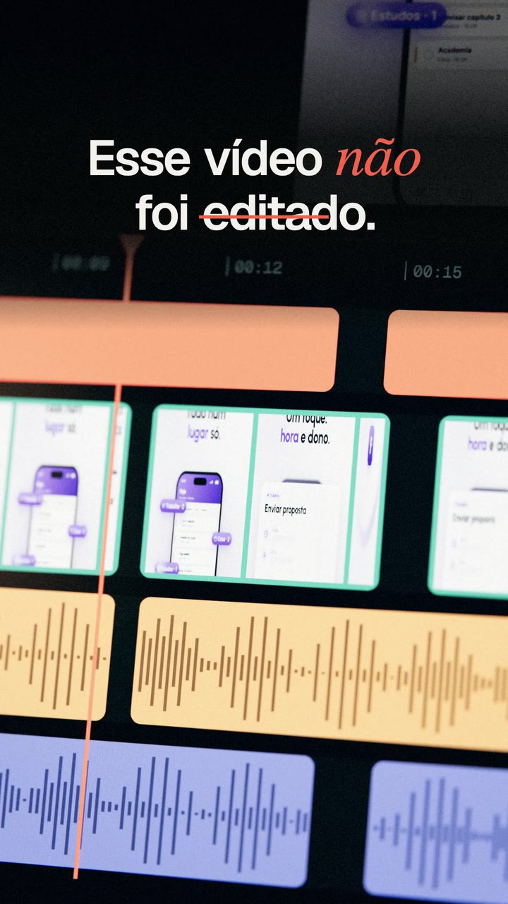
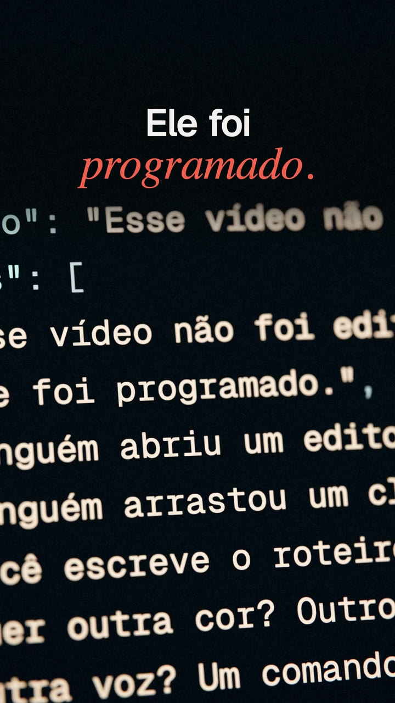
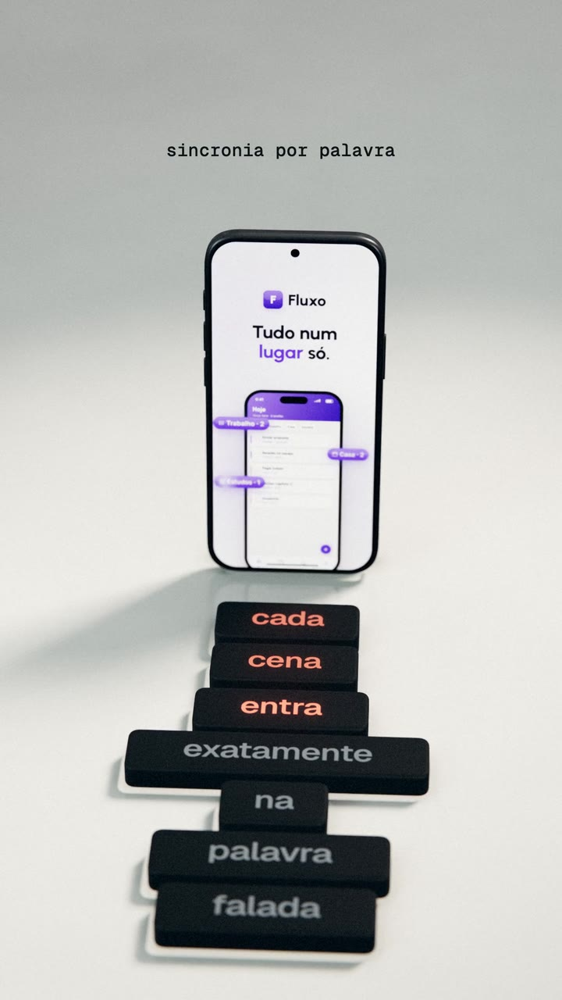
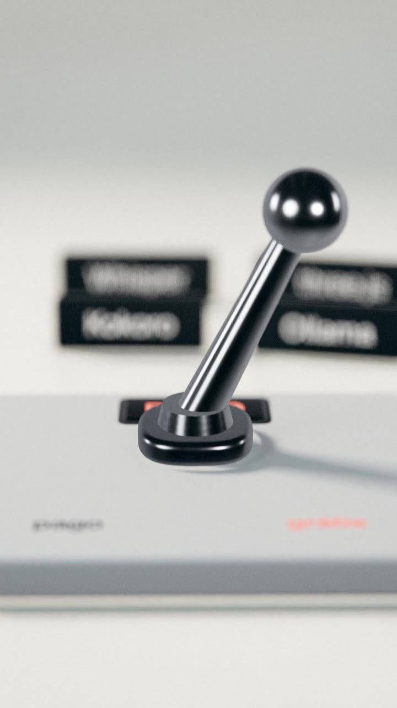

# 14. Estudo de caso: A bancada

[← 13. Som](13-som.md) · [Índice](README.md) · Depois: [Relatório técnico →](relatorio-tecnico.md)

Este é o making-of do anúncio do próprio projeto: o método inteiro aplicado a um filme real, do briefing ao MP4 de 60 fps. Tudo o que você vê aqui sai do código em [`exemplos/bancada/`](../exemplos/bancada/), e você pode renderizar o mesmo filme na sua máquina. O vídeo final está na [página de versões do repositório](https://github.com/FilipeMolinariMoura/fabrica-de-criativos/releases/latest).

<table>
<tr>
<td align="center"><br><sub>1a · gancho</sub></td>
<td align="center"><br><sub>1b · virada</sub></td>
<td align="center"><br><sub>6 · palavra falada</sub></td>
<td align="center"><br><sub>10 · custa zero</sub></td>
<td align="center"><br><sub>12b · cartão final</sub></td>
</tr>
</table>

## 14.1 Ficha

| | |
|---|---|
| **Filme** | A bancada |
| **Duração** | 35 s (narração de 32,8 s e 2,2 s de cartão final) |
| **Formato** | 1080×1920, 60 fps, H.264 |
| **Planos** | 16, com cortes secos |
| **Mundos de luz** | Escuro → claro cor de osso → escuro |
| **Motor** | `lib/3d` (three.js, WebGL) |
| **Amostras por quadro** | 192 no final, 128 na prévia |
| **Render final** | 2.100 quadros, de 35 a 40 minutos num Apple M1 Pro |
| **Voz** | ElevenLabs dirigida: voz 1 nas onze primeiras frases, voz 2 nas duas últimas. O mesmo filme sai com a narração gratuita (Kokoro ou Fish Audio) trocando só a voz |
| **Som** | Trilha e efeitos sintetizados em código (ou trilha da ElevenLabs Music alinhada à fala); −14,0 LUFS, pico −1,3 dBTP |
| **Material de terceiros** | Um HDRI, uma textura de madeira e um mapa de digitais (CC0); três fontes (OFL). Nenhum modelo 3D de terceiros |

## 14.2 Do briefing ao tratamento

1. **O briefing.** Um anúncio vertical de 35 s que prove, na própria forma, o que o projeto promete: um vídeo feito com código, narrado por IA, com cada cena presa à palavra falada, em 60 fps, a custo zero, com convite para o GitHub no fim.
2. **As referências.** Dezessete filmes de lançamento e anúncios ativos, destilados em 12 regras com números de partida ([capítulo 9](09-pesquisa-de-referencias.md)).
3. **O tratamento.** Uma frase: *o filme se passa num estúdio de produto, sobre uma bancada, e tudo o que o roteiro cita vira objeto físico.*
4. **O roteiro.** 78 palavras, gancho em negação e virada na segunda frase ([capítulo 7](07-roteiro-e-copy.md)).
5. **O look-dev.** Quatro quadros de estilo e um teste de movimento, aprovados antes de construir o filme ([capítulo 10](10-look-dev.md)).
6. **A voz.** Tom aprovado em amostras curtas, depois o roteiro dirigido em várias sementes ([capítulo 12](12-voz-dirigida.md)).
7. **O filme, o som e o render.** Este capítulo.

Cada ideia do roteiro virou um objeto:

| O roteiro diz | A bancada mostra |
|---|---|
| "não foi editado" | Um editor de vídeo em macro, com a timeline cheia |
| "foi programado" | A mesma tela: a timeline achata e vira as linhas do roteiro em código |
| "ninguém abriu um editor" | A tampa do notebook cai e quica |
| "ninguém arrastou um clipe" | Clipes de vidro saem sozinhos dos trilhos |
| "você escreve o roteiro" | A linha real do roteiro digitada no ritmo da fala |
| "a inteligência artificial narra" | Uma régua de pinos metálicos movida pelo volume real da narração |
| "cada cena entra na palavra falada" | Sete fichas, uma por palavra; cada uma acende na sua palavra e troca a cena do celular |
| "outra cor, outro estilo, outra voz" | O mesmo enquadramento em três cortes secos |
| "um comando só" | A tecla Enter em macro |
| "sessenta quadros por segundo" | O celular gira com desfoque de movimento e trava nítido |
| "custa zero" | Uma alavanca estala de "pago" para "grátis" |
| "o guia em PDF e o código" | O guia impresso, com páginas reais, e a página real do repositório |

## 14.3 Lista de planos

Cada corte acontece dois quadros antes da palavra indicada. Os tempos vêm do `vo.json` da narração.

| Plano | Entra em | Palavra do corte | Mundo | Lente | O que acontece | Legenda |
|---|---|---|---|---|---|---|
| 1a | 0,00 s | (quadro 0) | escuro | 100 mm, f/4 | Macro de um editor de vídeo; um clipe é arrastado e encaixa; "editado" é riscado | Esse vídeo *não* foi editado. |
| 1b | 2,38 s | "Ele" | escuro | 100 mm, f/4 | Mesma tomada: a câmera gira e a timeline achata em linhas do roteiro, cravando em "programado" | Ele foi *programado.* |
| 2 | 3,95 s | "Ninguém" | escuro | 50 mm, f/4 | A tampa do notebook cai e quica em "editor" | Ninguém abriu um *editor.* |
| 3 | 5,67 s | "Ninguém" | escuro | 100 mm, f/2,8 | Clipes de vidro saem dos trilhos; o último varre a lente | Ninguém arrastou um *clipe.* |
| 4 | 7,07 s | "Você" | claro | 85 mm, f/5,6 | Notebook no ciclorama digita a linha real do roteiro, palavra a palavra | Você escreve o *roteiro.* |
| 5 | 8,55 s | "a" | claro | 100 mm, f/2,8 | Régua de pinos movida pela envoltória real da narração; a cor da ponta indica a voz | A IA *narra.* |
| 6 | 10,77 s | "cada" | claro | 85 mm, f/5,6 | Sete fichas acendem, cada uma na sua palavra; a tela do celular troca de cena junto | (as fichas são o texto) |
| 7a | 14,07 s | "Quer" | coral claro | 85 mm, f/4 | Corte seco no mesmo enquadramento: o tema muda | Outra *cor?* |
| 7b | 14,97 s | "Outro" | grafite | 85 mm, f/4 | Corte seco: o estilo tipográfico muda | Outro *estilo?* |
| 7c | 16,07 s | "Outra" | verde claro | 85 mm, f/4 | Corte seco: os pinos trocam de cor e surge a etiqueta "voz 1 → voz 2" | Outra *voz?* |
| 8 | 16,99 s | "Um" | claro | 135 mm, f/9 | A tecla Enter afunda em "só"; o foco sobe para a saída do comando | Um comando *só.* |
| 9 | 18,37 s | "Sessenta" | claro | 85 mm, f/4 | O celular gira com desfoque de movimento e trava em "segundo"; um medidor mostra "60 fps" e "−14 LUFS" | 60 quadros por *segundo.* → Pronto pra *postar.* |
| 10 | 21,41 s | "E" | claro | 85 mm, f/4 | A alavanca recua, estala para "grátis" em "zero" e balança; o foco vai para as placas dos modelos abertos | Custa *zero.* → Modelos *abertos.* |
| 11 | 24,41 s | "O" | claro | 70 mm, f/4,5 | Entra a segunda voz. O guia impresso, e uma grua até a página do repositório | Método. → Guia em *PDF.* → Código *aberto.* |
| 12a | 28,99 s | "Procure" | escuro | 100 mm, f/4 | A busca é digitada na fala, vem o resultado, a estrela é tocada e fica acesa | Procure no *GitHub.* |
| 12b | 31,09 s | "crie" | escuro | 85 mm, f/4 | A bancada no escuro, a marca à frente; o cartão segura 2,7 s depois da voz | (cartão final) |

Dezesseis planos em 35 s dão média de 2,2 s por plano. A primeira ação acontece em 0,5 s, e a primeira troca forte de imagem, em 2,4 s.

O que precisa **bater** numa palavra (o estalo da alavanca, a trava do giro, a tampa) usa o início audível medido no áudio, porque o tempo da transcrição adianta de 50 a 235 ms.

## 14.4 O look

Dois mundos de luz contam a história: o **escuro** (bancada de madeira preta, recorte verde-petróleo, acento coral) abre e fecha o filme; o **claro** (ciclorama cor de osso) explica o método. As escolhas que dão ao filme o acabamento de fotografia de produto:

| Elemento | Escolha |
|---|---|
| Fundo claro | Osso quente, com foco de luz e cantos caindo cerca de um stop e meio; pelo menos 30% do quadro em osso |
| Contato com o chão | Decalque de sombra de contato por objeto: nada flutua |
| Vidro | Transmissão de verdade, com conteúdo atrás para refratar |
| Metal polido | Brilho só do ambiente, sem pontinhos de luz pontual |
| Régua de pinos | Girada 28°, com luz rasante, para ler como objeto e não como gráfico |
| Telas | Só conteúdo real: quadros do exemplo, as variantes, o `roteiro.json`, comandos do kit, a página do repositório. Cada variação mostra o que a legenda diz |
| Visor da alavanca | Nunca fica preto; "pago" e "grátis" sempre inteiros no quadro |
| Legendas | Uma linha de base fixa para todas; o assunto fica abaixo da faixa da legenda |
| Contraste das legendas | Medido sobre o quadro renderizado: tinta de 8,2:1 a 17,9:1 e acento de 4,96:1 a 11,0:1, todos acima do mínimo de 4,5:1 da WCAG |

Uma legenda do plano 11 ("Guia em PDF.") usa véu claro, porque a grua passa uma tela escura por trás dela.

## 14.5 Montagem e movimento

| Momento | Como foi resolvido |
|---|---|
| Gancho | Uma ação em 0,5 s: um clipe arrastado que encaixa |
| A virada | A transformação segura e resolve em 2 quadros, no início audível de "programado" |
| O giro do celular | Curva agressiva: 25° restantes a 80 ms da trava, sobressalto de 6° e assentamento |
| A tecla Enter | Afunda, segura, solta e acende; o foco sobe para o resultado |
| A estrela do CTA | Fica acesa por 0,6 s, tempo de leitura |
| Cartão final | Acorde, cama de música, botão que pulsa e câmera que continua se movendo |

Antes do render final, a prévia passou por dois críticos independentes, sem o histórico da construção: um de imagem, comparando quadros com as referências, e um de montagem e som, medindo tempos e níveis. As escolhas das tabelas acima e do capítulo de som incorporam essa revisão. Quem constrói não deve aprovar sozinho ([capítulo 8](08-qualidade-e-solucao-de-problemas.md)).

## 14.6 A voz

- **Voz 1**, no `eleven_v3`, com `language_code: "pt"` e marcações de tom (`[serious]` no gancho, `[dramatic]` na virada, `[curious]` nas perguntas, `[amazed]` em "custa zero").
- **Voz 2**, no `eleven_multilingual_v2` expressivo, só no convite final, dirigida por pontuação.
- As duas emendadas com pausa de 0,36 s, niveladas em −19,6 LUFS, e postas no tempo com `vo_montar.py --tempo 1.10`.
- Na imagem, a legenda muda de cor de acento quando a voz muda.

O texto dirigido completo e os comandos estão no [capítulo 12](12-voz-dirigida.md) e em [`exemplos/bancada/narracao.json`](../exemplos/bancada/narracao.json).

## 14.7 Som e render

- **Música:** composta sob a fala, com o tempo forte na virada e o CTA num tempo forte. A versão publicada usa uma trilha da ElevenLabs Music alinhada à narração; a trilha sintetizada do kit dá um filme completo e gratuito.
- **Efeitos:** 44 eventos, cada um preso ao mesmo instante que move a imagem.
- **Mixagem:** música 9,0 LU abaixo da voz nos intervalos, voz 14,3 dB acima da música durante a fala, master em −14,0 LUFS e pico de −1,3 dBTP ([capítulo 13](13-som.md#135-mixagem-que-se-ouve-os-ajustes-recomendados)).
- **Render:** prévia a 30 fps com 128 amostras por quadro em cerca de 14 minutos; final a 60 fps com 192 amostras em 35 a 40 minutos, num Apple M1 Pro.

## 14.8 Como reproduzir

Com o ambiente instalado ([capítulo 3](03-trilha-gratuita.md)) e `npm run verificar` sem pendências, da raiz do repositório. Os comandos `npm run …` funcionam igual no Windows, no macOS e no Linux.

A narração (`audio/vo.wav`) não está no repositório. Gere a sua seguindo o [capítulo 12](12-voz-dirigida.md) ou a [trilha gratuita](03-trilha-gratuita.md), e monte com `scripts/vo_montar.py`. O `vo.json` do repositório guarda os tempos da narração publicada; com outra voz, ele é refeito e o filme se reposiciona sozinho, porque tudo está preso às palavras.

```bash
npm run contato -- exemplos/bancada        # folha de contato, 2 quadros por plano
npm run audio   -- exemplos/bancada        # eventos, trilha, efeitos e mixagem
npm run previa  -- exemplos/bancada        # 30 fps, 128 amostras -> entrega/previas/
npm run final   -- exemplos/bancada        # 60 fps, 192 amostras -> entrega/finais/
npm run checar  -- entrega/finais/bancada.mp4
```

`previa` e `final` aceitam `--de S --ate S` (só um trecho, em segundos), `--spp N`, `--fps N` e `--sem-audio`. Por exemplo, para revisar só o gancho: `npm run previa -- exemplos/bancada --de 0 --ate 4`.

No macOS e no Linux, os atalhos do `Makefile` fazem o mesmo:

```bash
make final3d FILME=exemplos/bancada       # áudio, render a 60 fps e MP4 em entrega/finais/
make checar ARQS=entrega/finais/bancada.mp4
```

Passo a passo, com o renderizador direto (útil para entender cada etapa):

```bash
# conferir sem áudio: folha de contato e contraste das legendas
node lib/3d/render.mjs --film exemplos/bancada --contact --spp 24
node lib/3d/render.mjs --film exemplos/bancada --contrast

# som: eventos, trilha, efeitos e mixagem
node lib/3d/render.mjs --film exemplos/bancada --meta
uv run scripts/trilha.py exemplos/bancada
node lib/3d/render.mjs --film exemplos/bancada --meta
node vendor/motion-reel/skills/motion-reel/scripts/sfx.mjs exemplos/bancada
node vendor/motion-reel/skills/motion-reel/scripts/mix.mjs exemplos/bancada --no-mux \
  --music-db 2 --duck-threshold 0.08 --duck-ratio 3 --duck-attack 15 --duck-release 350

# final a 60 fps
node lib/3d/render.mjs --film exemplos/bancada --range 0:35 --fps 60 --spp 192 --crf 18 \
  --mp4 entrega/finais/bancada.mp4 --audio exemplos/bancada/audio/mix.wav
```

## 14.9 O que este caso ensina

1. **Prenda tudo à palavra.** Corte, foco, luz, objeto e som saem do mesmo tempo. Troque a voz e o filme inteiro se reposiciona.
2. **Transforme o roteiro em objetos.** Cada ideia falada ganha uma coisa física para a câmera filmar.
3. **Aprove o look barato.** Quatro quadros de estilo mostram para onde o filme vai antes de qualquer render longo.
4. **Dirija a voz.** Marcações de tom e amostras curtas levam a narração de correta a convincente.
5. **Meça o que importa.** Contraste das legendas, nível da música nos respiros, nível de cada efeito, loudness da entrega.
6. **Use um crítico independente.** Quem constrói não deve aprovar sozinho: olhos novos, com medidas, encontram o que falta.
7. **Escreva os números.** Lente, abertura, tempos e níveis registrados tornam o filme reproduzível, e o próximo, mais rápido.

---

Depois: [Relatório técnico →](relatorio-tecnico.md) · [Referências](referencias.md)
