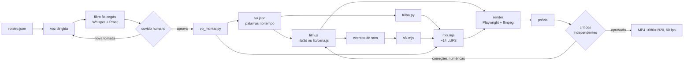

# Fábrica de Criativos: um método aberto e reprodutível para anúncios em vídeo a partir de código, com 3D fotorrealista, voz dirigida e crítica independente

**Filipe Molinari** · Relatório técnico · Versão 2.0 · Novembro de 2026

[Índice da documentação](README.md) · [Referências](referencias.md)

---

## Resumo

Anúncios em vídeo vertical para redes sociais exigem volume, variação e rapidez, e a produção em editores de timeline é manual e difícil de reproduzir. Este relatório descreve um método em que o vídeo é um programa: cada quadro é função pura do tempo, e cada evento do filme é ancorado no instante de uma palavra da narração.

Determinismo e sincronia tornam a produção reprodutível, mas a qualidade percebida precisa ser especificada e verificada à parte. A versão 2.0 do método faz isso com cinco componentes:

1. mineração de referências visuais sem baixar vídeo, que resultou em 12 regras com valores de partida;
2. uma etapa de look-dev, com quadros de estilo aprovados antes da construção;
3. um pipeline de render 3D em three.js que obtém profundidade de campo de lente fina, desfoque de movimento e sombra de luz de área por acumulação de 192 a 768 amostras por quadro;
4. um processo de direção de voz sintética, em que o tom é aprovado em amostras curtas e a aprovação final é humana;
5. crítica por agentes independentes do construtor, com medições objetivas de imagem e de som.

O estudo de caso é um filme de 35 s e 16 planos, entregue em 1080×1920 a 60 fps, com −14,0 LUFS integrados, pico verdadeiro de −1,3 dBTP, contraste de legenda acima de 4,5:1 em todos os planos e render final de 35 a 40 minutos num notebook. O relatório documenta o método, a arquitetura, as medidas de entrega e as limitações.

**Palavras-chave:** vídeo como código; publicidade digital; render procedural; profundidade de campo por acumulação; síntese de fala; agentes de IA; avaliação por críticos independentes.

## Abstract

Short-form vertical video ads demand volume, variation and speed, yet timeline-editor production is manual and hard to reproduce. This report describes a method in which the video is a program: each frame is a pure function of time, and every event in the film is anchored to the timestamp of a spoken word.

Determinism and sync make production reproducible, but perceived quality has to be specified and verified on its own. Version 2.0 of the method does this with five components: (1) reference mining without downloading videos, distilled into 12 rules with starting values; (2) a look-dev stage with style frames approved before building; (3) a three.js 3-D pipeline that obtains thin-lens depth of field, motion blur and area-light shadows by accumulating 192 to 768 samples per frame; (4) a directing process for synthetic voice, in which tone is approved on short samples and final approval is human; and (5) critique by agents independent of the builder, backed by objective picture and sound measurements.

The case study is a 35-second, 16-shot film delivered at 1080×1920 and 60 fps, at −14.0 LUFS integrated loudness and −1.3 dBTP true peak, with caption contrast above 4.5:1 in every shot and a final render of 35 to 40 minutes on a laptop. The report documents the method, the architecture, the delivery measurements and the limitations.

**Keywords:** video as code; digital advertising; procedural rendering; accumulation depth of field; text-to-speech; AI agents; independent-critic evaluation.

---

## 1 Introdução

Plataformas de vídeo curto favorecem anúncios verticais consumidos em rolagem rápida. Quem produz precisa de várias versões de cada peça, e a produção tradicional em editores de timeline cria três gargalos:

- **reprodutibilidade:** um ajuste de texto exige retrabalho manual;
- **variação:** cada versão é um projeto novo;
- **sincronia:** trocar a narração desalinha cenas e efeitos.

Tratar o vídeo como código resolve os três gargalos por construção. Há um quarto requisito, que o código sozinho não garante: **a qualidade percebida**. Um vídeo pode ser determinístico, sincronizado e dentro do padrão de loudness; para também parecer fotografia de produto e soar como um locutor de estúdio, a qualidade precisa ser especificada e verificada.

Este relatório trata desse quarto requisito. As perguntas são:

1. Como transformar um juízo estético em especificação mensurável?
2. É possível obter imagem com aparência de fotografia de produto em um navegador, mantendo o determinismo?
3. Como chegar a uma narração sintética aprovada por um ouvinte humano, e qual o papel da conferência automática?
4. Como evitar que o construtor aprove o próprio trabalho?

## 2 Fundamentação

### 2.1 Princípios de animação

Os princípios de Thomas e Johnston (1981), formalizados para a computação gráfica por Lasseter (1987), estabelecem que movimento crível exige aceleração e desaceleração, antecipação e continuidade de ação. No método, isso aparece como molas calculadas em forma fechada no motor 2D e como antecipação, sobressalto e assentamento explícitos no motor 3D.

### 2.2 Aprendizagem multimídia e carga cognitiva

Mayer (2009) prevê melhor compreensão quando palavra falada e imagem coincidem no tempo (contiguidade temporal), quando o elemento relevante é destacado (sinalização) e quando a narração não é duplicada em texto (redundância). Sweller (1988) justifica uma ideia por cena. O método operacionaliza a contiguidade ancorando cada evento a uma palavra.

### 2.3 Síntese e verificação de fala

Modelos neurais de síntese de fala erram sílaba tônica e entonação de forma imprevisível. O método usa o reconhecedor Whisper (Radford et al., 2023) às cegas e a medida da frequência fundamental no fim de frase com Praat e Parselmouth (Boersma; Weenink; Jadoul et al., 2018). A seção 5.4 discute o papel dessa verificação.

### 2.4 Loudness

A normalização segue a ITU-R BS.1770-4 e a EBU R 128, com alvo de −14 LUFS integrados e pico verdadeiro de até −1 dBTP.

### 2.5 Acumulação de amostras

Cook, Porter e Carpenter (1984) mostraram que distribuir amostras no tempo, na abertura da lente e na área das luzes produz desfoque de movimento, profundidade de campo e penumbra. Haeberli e Akeley (1990) levaram a ideia à rasterização com o buffer de acumulação. O pipeline deste trabalho aplica essa técnica em WebGL, com amostras de lente em espiral (Vogel, 1979) e sequências de baixa discrepância (Halton, 1960), e um passe de bloom por redução e ampliação sucessivas (Jimenez, 2014).

### 2.6 Contraste de texto

O critério de contraste das legendas é o da WCAG 2.2 para texto normal: razão mínima de 4,5:1.

## 3 Método

O processo tem dez etapas encadeadas por arquivos ([capítulo 1](01-metodo.md)): briefing, referências, roteiro, voz dirigida, narração no tempo, look-dev, filme, som, crítica independente e render com variações. Cada etapa tem um portão de qualidade.

### 3.1 Mineração de referências

Dezessete entradas (filmes de lançamento de software, filmes de produto físico e anúncios ativos em biblioteca pública de anúncios) foram lidas por miniaturas de pré-visualização e metadados públicos, sem baixar vídeo e sem áudio. Do conjunto saíram 12 regras com valores de partida, contra as quais cada filme é medido ([capítulo 9](09-pesquisa-de-referencias.md)).

### 3.2 Look-dev

Antes do filme, quatro quadros de estilo e um teste de movimento de 4 s são produzidos e avaliados contra critérios de realismo definidos antes da avaliação ([capítulo 10](10-look-dev.md)).

### 3.3 Sincronização pela fala

A narração aprovada é alinhada palavra a palavra. O filme consulta os tempos por palavra, e nunca guarda segundos fixos. Dois refinamentos foram introduzidos: cortes posicionados dois quadros antes da palavra, e impactos posicionados no início audível da palavra, medido no áudio.

### 3.4 Determinismo

O filme é função pura do tempo e, no motor 3D, do par (tempo, índice da amostra). Não há relógio nem gerador de números aleatórios não determinístico. O mesmo código produz o mesmo vídeo.

### 3.5 Direção de voz

O tom é aprovado em amostras de cerca de 10 s (gancho e CTA) em quatro a sete variações. Só então o roteiro é gerado, em cinco a oito tomadas com sementes distintas. A conferência automática elimina tomadas com erro objetivo, e duas finalistas vão a escuta humana ([capítulo 12](12-voz-dirigida.md)).

### 3.6 Crítica independente

Dois agentes sem acesso ao histórico da construção avaliam a prévia: um de imagem, um de montagem e som. Ambos devem medir o que for mensurável e devolver correções numéricas ([capítulo 8](08-qualidade-e-solucao-de-problemas.md)).

## 4 Arquitetura

O motor 3D ([capítulo 11](11-3d-fotorrealista.md)) tem cinco módulos: a câmera de acumulação, o estúdio (ambiente, chão com reflexo renderizado, luzes de área), os modelos (aparelhos genéricos em código), as telas e o renderizador. O acabamento é um único passe em HDR linear: bloom e halação restritos a um buffer de emissivos, aberração cromática lateral, vinheta, mapeamento de tons, gradação, legendas, grão e dither.

Componentes de terceiros: three.js, Playwright, ffmpeg, o motor `motion-reel` (MIT), Whisper, Praat, Kokoro, e as APIs da Fish Audio e da ElevenLabs. Materiais: um HDRI e duas texturas sob CC0, três famílias tipográficas sob SIL OFL.

## 5 Avaliação

A avaliação é um estudo de caso único: o anúncio do próprio projeto, um filme de 35 s chamado A bancada ([capítulo 14](14-estudo-de-caso-a-bancada.md)). Os tempos citados são de uma máquina de exemplo, um notebook com Apple M1 Pro e 16 GB; o kit roda em Windows, macOS e Linux.

### 5.1 Especificações de entrega

Medidas sobre o arquivo final e sobre os quadros renderizados:

| Medida | Valor | Referência |
|---|---|---|
| Resolução e cadência | 1080×1920, 60 fps, H.264 | formato vertical 9:16 |
| Duração e planos | 35 s, 16 planos, média de 2,2 s por plano | — |
| Primeira ação no gancho | 0,5 s | regras do capítulo 9 |
| Posição dos cortes | 2 quadros antes da palavra | seção 3.3 |
| Loudness integrado | −14,0 LUFS | alvo −14 LUFS (ITU-R BS.1770-4) |
| Pico verdadeiro | −1,3 dBTP | máximo −1 dBTP (EBU R 128) |
| Contraste das legendas, pior caso | tinta 8,2:1; acento 4,96:1 | mínimo 4,5:1 (WCAG 2.2) |
| Música nos intervalos da voz | 9,0 LU abaixo da voz | seção 5.5 |
| Voz acima da música durante a fala | 14,3 dB em média | — |
| Preto do mundo escuro (percentil 5 de luminância, quadros de look-dev) | 4/255 a 6/255 | ≤ 8/255 |

### 5.2 Look-dev

Quatro quadros de estilo (celular e macro no mundo escuro; vidro e cartão final no mundo claro) e um teste de movimento foram aprovados antes da construção. O look-dev orientou o investimento de iluminação no mundo claro, que recebeu foco de luz, fibra de papel e sombra de contato por objeto antes de o filme existir.

### 5.3 Custo de render

| Configuração | Tempo por quadro |
|---|---|
| 16 a 24 amostras (folha de contato) | 0,06 a 0,12 s |
| 128 amostras (prévia) | cerca de 0,4 s |
| 192 a 256 amostras (final) | 0,6 a 0,9 s |
| 768 amostras (quadro parado) | 2 a 3 s |
| Plano com vidro maciço, 192 amostras | cerca de 4,5 s |

O filme completo (2.100 quadros a 60 fps, 192 amostras) leva de 35 a 40 minutos. A prévia a 30 fps leva perto de 14 minutos.

### 5.4 Voz

Três motores foram avaliados de ouvido em português do Brasil: Kokoro-82M (local, aberto), Fish Audio `s2.1-pro-free` (gratuito) e ElevenLabs (`eleven_v3` e `eleven_multilingual_v2`, pagos). Todos passam na conferência automática e entregam narração de boa qualidade; os dois gratuitos produzem o anúncio completo sem custo. A narração do estudo de caso usa o ElevenLabs com direção explícita: marcações de tom, `language_code` forçado e várias sementes, com o tom aprovado antes em amostras de 10 s.

A conferência por reconhecimento e por frequência fundamental é condição necessária, e não suficiente: ela detecta erro de palavra e de contorno final, e não mede naturalidade nem emoção. Por isso o método a usa como filtro e reserva a aprovação para a escuta humana.

Uma geração completa do roteiro dirigido consome 547 caracteres. O processo inteiro (sete amostras de 10 s e oito tomadas completas) fica abaixo de 6 mil caracteres, num plano a partir de US$ 6 por mês com 30 mil créditos.

### 5.5 Crítica independente

Dois agentes sem o histórico da construção revisaram a prévia: um de imagem, comparando quadros com as referências, e um de montagem e som, medindo tempos e níveis. Cada observação voltou como correção numérica, aplicada e medida de novo. As medidas que resultaram dessa revisão integram a seção 5.1. Entre elas:

| Aspecto | Medida adotada |
|---|---|
| Contraste das legendas | medido sobre o quadro renderizado, atrás de cada legenda (pior 5% da caixa) |
| Sidechain da música | limiar 0,08, razão 3:1, ataque 15 ms, soltura 350 ms, música +2 dB |
| Nível dos efeitos | nenhum efeito mais de 15 dB abaixo da voz; pico sob a fala perto de −8 dBFS |
| Impactos sincronizados | no início audível da palavra, medido no áudio, compensando o adiantamento de 50 a 235 ms (média perto de 140 ms) do tempo de transcrição |
| Gancho | primeira ação em até 0,5 s |

### 5.6 Aplicação em produção

O motor 2D do método foi aplicado pelo autor numa produção real, cujos materiais não são publicados. A partir de um piloto, ela resultou em oito criativos de 20 a 30 segundos e 18 variações de cor, estilo e voz, todos em 1080×1920 e 60 fps.

## 6 Limitações

- **Escopo da avaliação.** Um estudo de caso, com aprovação humana do autor; não há painel de espectadores nem dados de veiculação (retenção, clique, conversão).
- **Referências.** Lente, abertura e ocupação de quadro das referências são estimativas visuais sobre miniaturas de 320×180 px.
- **Render.** O pipeline é rasterizado e não calcula iluminação global nem cáusticas. Os tempos de render citados são de uma máquina de exemplo e variam com a placa de vídeo.
- **Serviços externos.** A narração do estudo de caso usa um serviço pago; a trilha gratuita produz o mesmo filme com narração aberta. Preços, modelos e termos de APIs de voz são de novembro de 2026.

## 7 Considerações éticas

- **Veracidade do anúncio.** O filme afirma que "foi programado" e que "os modelos são abertos". Por isso o corte principal não usa vídeo generativo. A documentação declara que a narração veiculada usa um serviço pago.
- **Voz sintética.** A veiculação deve seguir as políticas de conteúdo gerado por IA de cada plataforma. Clonar a voz de terceiros exige consentimento. O método recomenda não usar vozes que imitam pessoas reais.
- **Licenças.** Planos gratuitos de serviços de voz podem vedar uso comercial, e pesos de alguns modelos abertos são não comerciais. O kit documenta a licença de cada componente.
- **Marcas de terceiros.** Os aparelhos do filme são genéricos, modelados em código, sem logotipo.
- **Referências.** Nenhum vídeo de terceiros foi baixado ou redistribuído. O repositório guarda endereços e anotações.
- **Materiais de clientes.** Não entram no repositório público. O `.gitignore` exclui áudio, vídeo e chaves.
- **Alegações.** O método proíbe telas inventadas e números sem fonte, e este relatório não faz alegação de desempenho de veiculação.

## 8 Conclusão

Tratar o anúncio como programa torna a produção reprodutível, variável e sincronizada por construção. A versão 2.0 acrescenta ao método os meios de mirar a qualidade percebida e de verificá-la: regras extraídas de referências, aprovação de aparência antes da construção, um pipeline de imagem que reproduz o comportamento de uma lente, direção explícita da voz sintética e crítica por agentes que não participaram da construção.

Três resultados parecem generalizáveis para além deste caso:

1. **Conferência automática é filtro, e a aprovação é humana.** Isso vale para a voz e para a imagem.
2. **Um juízo estético pode ser decomposto em medidas.** Ocupação do quadro, profundidade do preto, frequência de cortes, movimento de câmera, contraste e níveis de som tornam "aparência premium" uma especificação.
3. **A independência do crítico importa mais que a sofisticação da rubrica.** Um agente sem o histórico da construção, munido de medidas, encontra o que o construtor deixa passar.

Trabalhos futuros:

- medir o efeito das técnicas sobre retenção e conversão em testes controlados;
- repetir a avaliação com painel de ouvintes e de espectadores;
- avaliar vozes nativas em português do Brasil, pagas e abertas;
- acrescentar iluminação global aproximada ao pipeline 3D;
- medir o pipeline em outras GPUs e sistemas.

## Referências

Ver [referencias.md](referencias.md).
