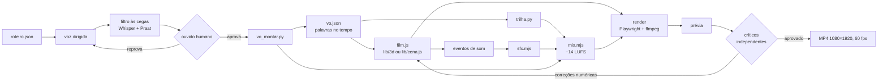

# Fábrica de Criativos: um método aberto e reprodutível para anúncios em vídeo a partir de código, com 3D fotorrealista, voz dirigida e crítica independente

**Filipe Molinari** · Relatório técnico · Versão 2.0 · Novembro de 2026

[Índice da documentação](README.md) · [Referências](referencias.md)

---

## Resumo

Anúncios em vídeo vertical para redes sociais exigem volume, variação e rapidez, e a produção em editores de timeline é manual e difícil de reproduzir. Este relatório descreve um método em que o vídeo é um programa: cada quadro é função pura do tempo, e cada evento do filme é ancorado no instante de uma palavra da narração.

A primeira versão do método produzia motion design em 2D e foi reprovada pelo autor no anúncio do próprio projeto, embora passasse em todas as conferências automáticas. A versão 2.0 responde a essa reprovação com cinco componentes:

1. mineração de referências visuais sem baixar vídeo, que resultou em 12 regras com valores de partida;
2. uma etapa de look-dev, com quadros de estilo e nota de realismo antes da construção;
3. um pipeline de render 3D em three.js que obtém profundidade de campo de lente fina, desfoque de movimento e sombra de luz de área por acumulação de 192 a 768 amostras por quadro;
4. um processo de direção de voz sintética, em que o tom é aprovado em amostras curtas e a aprovação final é humana;
5. crítica por agentes independentes do construtor, com medições objetivas de imagem e de som.

No estudo de caso, um filme de 35 s e 16 planos, os críticos independentes atribuíram à primeira prévia notas entre 5 e 7,5. Depois de uma rodada de correções numéricas, todos os critérios registrados ficaram em 8 ou mais, com uma exceção (realismo do mundo claro, 7,5). O relatório documenta o que foi medido, o que foi estimado, as tentativas reprovadas e as limitações. Não há dados de desempenho de veiculação.

**Palavras-chave:** vídeo como código; publicidade digital; render procedural; profundidade de campo por acumulação; síntese de fala; agentes de IA; avaliação por críticos independentes.

## Abstract

Short-form vertical video ads demand volume, variation and speed, yet timeline-editor production is manual and hard to reproduce. This report describes a method in which the video is a program: each frame is a pure function of time, and every event in the film is anchored to the timestamp of a spoken word.

The first version of the method produced 2-D motion design and was rejected by its author for the project's own ad, even though it passed every automated check. Version 2.0 answers that rejection with five components: (1) reference mining without downloading videos, distilled into 12 rules with starting values; (2) a look-dev stage with style frames and an honest realism score before building; (3) a three.js 3-D pipeline that obtains thin-lens depth of field, motion blur and area-light shadows by accumulating 192 to 768 samples per frame; (4) a directing process for synthetic voice, in which tone is approved on short samples and final approval is human; and (5) critique by agents independent of the builder, backed by objective picture and sound measurements.

In the case study, a 35-second, 16-shot film, independent critics scored the first preview between 5 and 7.5. After one round of numeric corrections every recorded criterion reached 8 or higher, with one exception (realism of the light world, 7.5). The report states what was measured, what was estimated, which attempts were rejected, and the limitations. No ad-delivery performance data is reported.

**Keywords:** video as code; digital advertising; procedural rendering; accumulation depth of field; text-to-speech; AI agents; independent-critic evaluation.

---

## 1 Introdução

Plataformas de vídeo curto favorecem anúncios verticais consumidos em rolagem rápida. Quem produz precisa de várias versões de cada peça, e a produção tradicional em editores de timeline cria três gargalos:

- **reprodutibilidade:** um ajuste de texto exige retrabalho manual;
- **variação:** cada versão é um projeto novo;
- **sincronia:** trocar a narração desalinha cenas e efeitos.

A hipótese da primeira versão deste trabalho era que tratar o vídeo como código resolve os três gargalos. Ela se confirmou no plano mecânico. A experiência mostrou, porém, um quarto problema, que código não resolve por si: **a qualidade percebida**. Um vídeo pode ser determinístico, sincronizado, dentro do padrão de loudness, aprovado por rubrica, e ainda assim ser recusado por quem assiste.

Este relatório trata do quarto problema. As perguntas são:

1. Como transformar um veredito subjetivo ("parece cru") em especificação mensurável?
2. É possível obter imagem com aparência de fotografia de produto em um navegador, mantendo o determinismo?
3. Como chegar a uma narração sintética aprovada por um ouvinte humano, e qual o papel da conferência automática?
4. Como evitar que o construtor aprove o próprio trabalho?

## 2 Fundamentação

### 2.1 Princípios de animação

Os princípios de Thomas e Johnston (1981), formalizados para a computação gráfica por Lasseter (1987), estabelecem que movimento crível exige aceleração e desaceleração, antecipação e continuidade de ação. No método, isso aparece como molas calculadas em forma fechada no motor 2D e como antecipação, sobressalto e assentamento explícitos no motor 3D.

### 2.2 Aprendizagem multimídia e carga cognitiva

Mayer (2009) prevê melhor compreensão quando palavra falada e imagem coincidem no tempo (contiguidade temporal), quando o elemento relevante é destacado (sinalização) e quando a narração não é duplicada em texto (redundância). Sweller (1988) justifica uma ideia por cena. O método operacionaliza a contiguidade ancorando cada evento a uma palavra.

### 2.3 Síntese e verificação de fala

Modelos neurais de síntese de fala erram sílaba tônica e entonação de forma imprevisível. O método usa o reconhecedor Whisper (Radford et al., 2023) às cegas e a medida da frequência fundamental no fim de frase com Praat e Parselmouth (Boersma; Weenink; Jadoul et al., 2018). A seção 5.4 mostra o limite dessa verificação.

### 2.4 Loudness

A normalização segue a ITU-R BS.1770-4 e a EBU R 128, com alvo de −14 LUFS integrados e pico verdadeiro de até −1 dBTP.

### 2.5 Acumulação de amostras

Cook, Porter e Carpenter (1984) mostraram que distribuir amostras no tempo, na abertura da lente e na área das luzes produz desfoque de movimento, profundidade de campo e penumbra. Haeberli e Akeley (1990) levaram a ideia à rasterização com o buffer de acumulação. O pipeline deste trabalho aplica essa técnica em WebGL, com amostras de lente em espiral (Vogel, 1979) e sequências de baixa discrepância (Halton, 1960), e um passe de bloom por redução e ampliação sucessivas (Jimenez, 2014).

### 2.6 Contraste de texto

O critério de contraste das legendas é o da WCAG 2.2 para texto normal: razão mínima de 4,5:1.

## 3 Método

O processo tem dez etapas encadeadas por arquivos ([capítulo 1](01-metodo.md)): briefing, referências, roteiro, voz dirigida, narração no tempo, look-dev, filme, som, crítica independente e render com variações. Cada etapa tem um portão de qualidade.

### 3.1 Mineração de referências

Dezessete entradas (filmes de lançamento de software, filmes de produto físico e anúncios ativos em biblioteca pública de anúncios) foram lidas por miniaturas de pré-visualização e metadados públicos, sem baixar vídeo e sem áudio. Do conjunto saíram 12 regras com valores de partida, e o filme reprovado foi medido contra elas ([capítulo 9](09-pesquisa-de-referencias.md)).

### 3.2 Look-dev

Antes do filme, quatro quadros de estilo e um teste de movimento de 4 s foram produzidos e avaliados numa escala de realismo de 1 a 10, definida antes da avaliação ([capítulo 10](10-look-dev.md)).

### 3.3 Sincronização pela fala

A narração aprovada é alinhada palavra a palavra. O filme consulta os tempos por palavra, e nunca guarda segundos fixos. Dois refinamentos foram introduzidos: cortes posicionados dois quadros antes da palavra, e impactos posicionados no início audível da palavra, medido no áudio.

### 3.4 Determinismo

O filme é função pura do tempo e, no motor 3D, do par (tempo, índice da amostra). Não há relógio nem gerador de números aleatórios não determinístico. O mesmo código produz o mesmo vídeo.

### 3.5 Direção de voz

O tom é aprovado em amostras de cerca de 10 s (gancho e CTA) em quatro a sete variações. Só então o roteiro é gerado, em cinco a oito tomadas com sementes distintas. A conferência automática elimina tomadas com erro objetivo, e duas finalistas vão a escuta humana ([capítulo 12](12-voz-dirigida.md)).

### 3.6 Crítica independente

Dois agentes sem acesso ao histórico da construção avaliam a prévia: um de imagem, um de montagem e som. Ambos devem medir o que for mensurável e devolver correções numéricas ([capítulo 8](08-qualidade-e-solucao-de-problemas.md)).

## 4 Arquitetura

O motor 3D ([capítulo 11](11-3d-fotorrealista.md)) tem cinco módulos: a câmera de acumulação, o estúdio (ambiente, chão com reflexo renderizado, luzes de área), os modelos (aparelhos genéricos em código), as telas e o renderizador. O acabamento é um único passe em HDR linear: bloom e halação restritos a um buffer de emissivos, aberração cromática lateral, vinheta, mapeamento de tons, gradação, legendas, grão e dither.

Componentes de terceiros: three.js, Playwright, ffmpeg, o motor `motion-reel` (MIT), Whisper, Praat, Kokoro, e as APIs da Fish Audio e da ElevenLabs. Materiais: um HDRI e duas texturas sob CC0, três famílias tipográficas sob SIL OFL.

## 5 Avaliação

A avaliação é um estudo de caso único: o anúncio do próprio projeto, um filme de 35 s chamado A bancada ([capítulo 14](14-estudo-de-caso-a-bancada.md)). Todos os tempos são de um Apple M1 Pro com 16 GB.

### 5.1 Ponto de partida

O filme 2D reprovado, medido em 12 quadros amostrados:

| Medida | Valor |
|---|---|
| Área do quadro ocupada por conteúdo | 3% a 21%, mediana perto de 11% |
| Preto mais escuro (percentil 5 de luminância) | 23/255 |
| Cortes secos em 32 s | 0 |
| Notas da rubrica do construtor, rodada 4 | todas ≥ 8 |

A última linha é o resultado mais importante desta seção: a rubrica aplicada pelo construtor não detectou o problema que levou à reprovação.

### 5.2 Look-dev

| Quadro | Nota de realismo | Percentil 5 de luminância |
|---|---|---|
| A, celular, mundo escuro | 8 | 6/255 |
| B, macro, mundo escuro | 8 | 4/255 |
| C, vidro, mundo claro | 7 | — |
| D, cartão final, mundo claro | 7 | — |

Média de 7,5. O look-dev identificou o mundo claro como o ponto mais fraco antes de o filme existir.

### 5.3 Custo de render

| Configuração | Tempo por quadro |
|---|---|
| 16 a 24 amostras (folha de contato) | 0,06 a 0,12 s |
| 128 amostras (prévia) | cerca de 0,4 s |
| 192 a 256 amostras (final) | 0,6 a 0,9 s |
| 768 amostras (quadro parado) | 2 a 3 s |
| Plano com vidro maciço, 192 amostras | cerca de 4,5 s |

O filme completo (2.100 quadros a 60 fps, 192 amostras) leva de 35 a 40 minutos. A prévia a 30 fps leva perto de 14 minutos.

### 5.4 Voz

Quatro abordagens foram submetidas à aprovação de ouvido do autor:

| Abordagem | Conferência automática | Escuta |
|---|---|---|
| Kokoro-82M, em bloco | passa | reprovada |
| Fish Audio `s2.1-pro-free`, frase a frase | passa | reprovada |
| ElevenLabs `eleven_v3`, modo diálogo, sem direção | passa | reprovada |
| ElevenLabs com direção (marcações de tom, `language_code`, sementes) | passa | aprovada |

A conferência automática aprovou as quatro. Narrações com pontuação máxima foram reprovadas na escuta. Conclui-se que a conferência por reconhecimento e por frequência fundamental é condição necessária e não suficiente: ela detecta erro de palavra e de contorno final, e não mede naturalidade nem emoção.

O custo total das tentativas na API paga foi da ordem de 12 a 15 mil créditos (estimativa pelo saldo da conta), num plano de US$ 5 por mês com 30 mil créditos. Uma geração completa do roteiro dirigido consome 547 caracteres.

### 5.5 Crítica independente

| Critério | Prévia 1, críticos independentes | Rodada 5, depois das correções |
|---|---|---|
| Realismo | 6 (escuro 7,5; claro 5) | escuro 8,5; claro 7,5 |
| Composição | 6 | 8 |
| Tipografia | 6,5 | 8,5 |
| Acabamento | 6 | 8 |
| Consistência | 5,5 | 8 |
| Gancho | 6,5 | 8,5 |
| Ritmo / movimento | 6,5 / 6 | 8 |
| Desenho de som | 5 | 8 |
| História sem som | 7 | 8,5 |
| CTA | 7,5 | 8 |

**Ameaça à validade.** As notas da primeira coluna são dos críticos independentes. As da segunda foram registradas pelo construtor depois de aplicar as correções, com apoio em medições refeitas; a de som é declarada no registro como nota de construção. Uma segunda avaliação completa pelos mesmos críticos independentes não está documentada. A comparação deve ser lida como evidência de que as correções pedidas foram aplicadas e medidas, e não como reavaliação cega.

Medições objetivas associadas às correções:

| Medida | Antes | Depois |
|---|---|---|
| Contraste das legendas (WCAG), pior caso | 1,0:1 | tinta ≥ 8,2:1; acento ≥ 4,96:1 |
| Música nos intervalos da voz | 14,8 LU abaixo da voz | 9,0 LU abaixo |
| Eventos de som inaudíveis (15 a 27 dB abaixo da voz) | cerca de 25 de 44 | corrigidos por ganho e reposicionamento |
| Tempo até a primeira ação no gancho | 1,7 s | até 0,5 s |
| Adiantamento do tempo de palavra da transcrição em relação ao início audível | 50 a 235 ms, média perto de 140 ms | compensado com início de energia medido |
| Loudness do arquivo final | — | −14,0 LUFS; pico −1,3 dBTP |

### 5.6 Aplicação anterior

A primeira versão do método foi aplicada pelo autor numa produção real, cujos materiais não são publicados. Ela resultou em oito criativos de 20 a 30 segundos e 18 variações de cor, estilo e voz a partir de um piloto, todos em 1080×1920 e 60 fps. Não há métricas de veiculação dessa aplicação neste relatório.

## 6 Limitações

- **Um estudo de caso, um avaliador humano.** A aprovação de imagem e de voz é a do autor. Não houve painel de ouvintes nem teste cego com público.
- **Sem dados de desempenho.** Nenhuma medida de retenção, clique ou conversão. O método não afirma que o filme produzido vende mais.
- **Referências lidas por miniaturas.** Lente, abertura e ocupação de quadro das referências são estimativas visuais sobre imagens de 320×180 px. O som das referências não foi ouvido.
- **Rasterização.** O pipeline não calcula iluminação global nem cáusticas. É a causa provável da nota 7,5 no mundo claro.
- **Uma máquina.** Os tempos de render são de um único computador.
- **A voz aprovada é paga.** As duas alternativas gratuitas testadas foram reprovadas na escuta para este anúncio. A trilha gratuita produz um vídeo completo, com narração mais neutra.
- **Voz não nativa.** As vozes padrão usadas são de origem americana. O ajuste de idioma e a direção reduziram, sem eliminar, a melodia estrangeira.
- **Mixagem conferida por medida.** Não houve escuta crítica independente depois das correções de som.
- **After Effects.** Os scripts de logo em `ae/logo3d/` não foram testados nesta versão genérica.
- **Dependência de serviços.** APIs de voz mudam preços, modelos e termos. Os valores são de novembro de 2026.

## 7 Considerações éticas

- **Veracidade do anúncio.** O filme afirma que "foi programado" e que "os modelos são abertos". Por isso o corte principal não usa vídeo generativo. A documentação declara que a narração veiculada usa um serviço pago.
- **Voz sintética.** A veiculação deve seguir as políticas de conteúdo gerado por IA de cada plataforma. Clonar a voz de terceiros exige consentimento. O método recomenda não usar vozes que imitam pessoas reais.
- **Licenças.** Planos gratuitos de serviços de voz podem vedar uso comercial, e pesos de alguns modelos abertos são não comerciais. O kit documenta a licença de cada componente.
- **Marcas de terceiros.** Os aparelhos do filme são genéricos, modelados em código, sem logotipo.
- **Referências.** Nenhum vídeo de terceiros foi baixado ou redistribuído. O repositório guarda endereços e anotações.
- **Materiais de clientes.** Não entram no repositório público. O `.gitignore` exclui áudio, vídeo e chaves.
- **Alegações.** O método proíbe telas inventadas e números sem fonte, e este relatório não apresenta alegação de desempenho.

## 8 Conclusão

Tratar o anúncio como programa torna a produção reprodutível, variável e sincronizada por construção. Isso não garante qualidade percebida. A versão 2.0 acrescenta ao método os meios de mirá-la e de verificá-la: regras extraídas de referências, aprovação de aparência antes da construção, um pipeline de imagem que reproduz o comportamento de uma lente, direção explícita da voz sintética e crítica por agentes que não participaram da construção.

Três resultados parecem generalizáveis para além deste caso:

1. **Conferência automática é filtro, e não aprovação.** Isso valeu para a voz e para a rubrica visual.
2. **Um veredito subjetivo pode ser decomposto em medidas.** "Cru" correspondeu a quadro vazio, preto lavado e ausência de corte, câmera e luz.
3. **A independência do crítico importa mais que a sofisticação da rubrica.** A mesma classe de agente que não viu os defeitos ao construir os encontrou ao criticar.

Trabalhos futuros:

- medir o efeito das técnicas sobre retenção e conversão em testes controlados;
- repetir a avaliação com painel de ouvintes e de espectadores;
- avaliar vozes nativas em português do Brasil, pagas e abertas;
- acrescentar iluminação global aproximada ao mundo claro;
- medir o pipeline em outras GPUs e sistemas.

## Referências

Ver [referencias.md](referencias.md).
