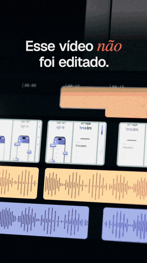

# A bancada

O anúncio de divulgação do projeto, feito como **filme de produto**: tudo o que o roteiro cita é um
objeto físico numa bancada de estúdio, fotografado com lente longa e pouca profundidade de campo.
35 s, 9:16, renderizado em three.js pelo pipeline de `lib/3d` (materiais físicos, profundidade de
campo e desfoque de movimento por acumulação, sombras de luz de área, reflexo real no tampo).



Dois mundos de luz: **escuro** (bancada de madeira preta, recorte verde-petróleo, acento coral) no
gancho e no CTA; **claro** (ciclorama cor de osso) no método. Telas só com conteúdo real: quadros de
`exemplos/demo`, as variantes, o `roteiro.json`, comandos do kit, a página do repositório.

## Planos (cada corte sai da palavra, 2 quadros antes do início dela no `vo.json`)

| Plano | Entra em | Palavra do corte | O que acontece |
|---|---|---|---|
| 1a | 0,00 s | (quadro 0) | Macro de um editor de vídeo; um clipe é arrastado e encaixa; "editado" é riscado |
| 1b | 2,38 s | "Ele" | Mesma tomada: a câmera gira e a timeline achata em linhas do roteiro, cravando em "programado" |
| 2 | 3,95 s | "Ninguém" (abriu) | A tampa do notebook cai e quica em "editor" |
| 3 | 5,67 s | "Ninguém" (arrastou) | Clipes de vidro saem dos trilhos; o último varre a lente |
| 4 | 7,07 s | "Você" | Notebook no ciclorama digita a linha real do roteiro, palavra a palavra, na fala |
| 5 | 8,55 s | "a" (inteligência) | Régua de pinos movida pela envoltória real da narração; cor da ponta = voz |
| 6 | 10,77 s | "cada" | Sete fichas acendem cada uma na sua palavra; a tela do celular troca de cena junto |
| 7a / 7b / 7c | 14,07 / 14,97 / 16,07 s | "Quer" / "Outro" / "Outra" | Mesmo enquadramento, três cortes secos: tema, estilo, voz (pinos de coral para verde) |
| 8 | 16,99 s | "Um" | Tecla Enter afunda em "só"; o foco sobe para a saída do comando real |
| 9 | 18,37 s | "Sessenta" | Celular gira com desfoque de movimento e trava em "segundo"; medidor "60 fps / -14 LUFS" |
| 10 | 21,41 s | "E" (custa) | Alavanca estala de "pago" para "grátis" em "zero"; foco nas placas dos modelos abertos |
| 11 | 24,41 s | "O" (método) | Entra a segunda voz. Guia impresso (páginas reais do PDF), grua até a página do GitHub |
| 12a | 28,99 s | "Procure" | Busca digitada na fala, resultado, estrela |
| 12b | 31,09 s | "crie" | Bancada no escuro, marca à frente, cartão final (segura 2,7 s depois da voz) |

O que precisa **bater** numa palavra (impacto, estalo, trava) usa `on()`: o início audível medido no
`vo.wav` (`assets/onsets.json`), porque o `vo.json` adianta de 50 a 235 ms.

## Como rodar (da raiz do repositório)

Com o ambiente instalado (`npm run verificar` sem pendências; veja o
[capítulo 3](../../docs/03-trilha-gratuita.md)). A narração (`audio/vo.wav`) não está no repositório:
gere a sua ([capítulo 12](../../docs/12-voz-dirigida.md)) e refaça `vo.json`; `narracao.json` diz como
esta foi feita.

A música do vídeo publicado foi gerada na ElevenLabs Music a partir de `musica.json` e alinhada à fala com
`scripts/trilha_eleven.py` ([capítulo 13](../../docs/13-som.md)). Os comandos abaixo usam a trilha
sintetizada, que é grátis e dá um filme completo.

Os comandos `npm run …` funcionam igual no Windows, no macOS e no Linux:

```bash
npm run contato -- exemplos/bancada        # folha de contato
npm run audio   -- exemplos/bancada        # eventos, trilha, efeitos e mixagem (-14 LUFS)
npm run previa  -- exemplos/bancada        # 30 fps, 128 spp -> entrega/previas/
npm run final   -- exemplos/bancada        # 60 fps, 192 spp -> entrega/finais/
npm run checar  -- entrega/finais/bancada.mp4
```

`previa` e `final` aceitam `--de S --ate S --spp N --fps N --sem-audio`. No macOS e no Linux, o
equivalente com `make` é `make contato3d|audio3d|previa3d|final3d FILME=exemplos/bancada`.

Passo a passo, com o renderizador direto:

```bash
# 1. tempos e sons a partir da fala  -> trilha.json + out/exemplos/bancada/hits.json
node lib/3d/render.mjs --film exemplos/bancada --meta
# 2. trilha, efeitos e mixagem (-14 LUFS). A música abaixa menos sob a voz que o padrão do vendor:
uv run scripts/trilha.py exemplos/bancada
node lib/3d/render.mjs --film exemplos/bancada --meta        # de novo: agora com beats.json
node vendor/motion-reel/skills/motion-reel/scripts/sfx.mjs exemplos/bancada
node vendor/motion-reel/skills/motion-reel/scripts/mix.mjs exemplos/bancada --no-mux \
  --music-db 2 --duck-threshold 0.08 --duck-ratio 3 --duck-attack 15 --duck-release 350
# 3. conferir: folha de contato (e meia-folha "celular") e contraste das legendas
node lib/3d/render.mjs --film exemplos/bancada --contact --spp 24
node lib/3d/render.mjs --film exemplos/bancada --contrast
# 4. prévia (30 fps) e final (60 fps)
node lib/3d/render.mjs --film exemplos/bancada --range 0:35 --fps 30 --spp 128 --crf 20 \
  --mp4 entrega/previas/bancada-previa.mp4 --audio exemplos/bancada/audio/mix.wav
node lib/3d/render.mjs --film exemplos/bancada --range 0:35 --fps 60 --spp 192 --crf 18 \
  --mp4 entrega/finais/bancada.mp4 --audio exemplos/bancada/audio/mix.wav
```

`window.ACABAMENTO` no `index.html` (ou `--q "acabamento=limpo"`) desliga grão, vinheta, halação e
aberração para uma finalização externa; `--limpo <arquivo>` grava esse master junto, do mesmo render.

## Tempo de render (exemplo: notebook com Apple M1 Pro, 16 GB)

| | Quadros | Render por quadro | Total |
|---|---|---|---|
| Folha de contato, 20 spp | 16 | 0,12 s | segundos |
| Prévia 30 fps, 128 spp | 1.017 | 0,42 s | 14 min |
| Final 60 fps, 192 spp | 2.100 | 0,70 s | 39 min |

O plano 3 (vidro de verdade, em duas camadas) custa sozinho cerca de um quarto do total.

## Notas de acabamento

- **Mundo claro**: foco de luz, fibra de papel e sombra de contato por objeto dão ao ciclorama o ar de
  estúdio fotográfico.
- **Legendas**: contraste medido sobre o quadro renderizado (`--contrast`), todas acima de 4,5:1. Uma
  legenda do plano 11 ("Guia em PDF.") usa véu claro, porque a grua passa a tela escura por trás.
- **Mixagem**: −14,0 LUFS integrados, pico −1,3 dBTP, música 9 LU abaixo da voz nos respiros.
- **Para ir além**: desgaste e poeira nos objetos metálicos (chave, medidor, placas) aproximam ainda
  mais o filme de uma fotografia.

O making-of completo está no
[capítulo 14](../../docs/14-estudo-de-caso-a-bancada.md).
